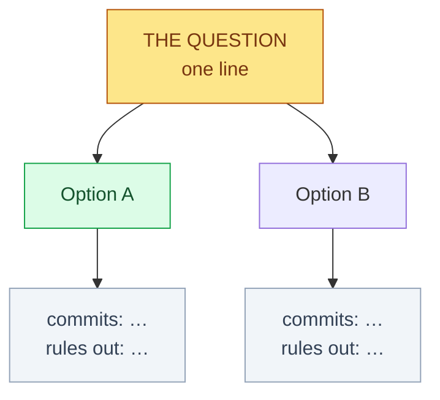

# HACP decision surface

Turn a blocked decision into a page a human can decide **on**.

A prose dispatch explains a decision. A decision surface **presents** one: the junction visible at a
glance, each option's evidence cited to a source, and each option's consequence stated as what it
commits you to and what it rules out. The test of this skill is not whether the page is thorough. It is
whether a human can open it and choose **without reading the thread**.

## When to use it, and when not

**Use it** when forward progress is gated on a human choice AND at least one holds:
- prose dispatches have already gone back and forth without the decision being taken;
- there are more than two options, or more than one dimension to trade off;
- the evidence lives in several places — different refs, records, code, and prior rulings;
- the decision will be cited later, so whose claim is whose has to be legible.

**Do not use it** for:
- a decision you can make yourself under delegated authority — make it, record the route, move on;
- a one-question blocker — that is `/grill-me`'s single-round form and a page is overhead;
- a status report. If no human decision is required, do not invent one.

`/grill-me` resolves a *dependency chain* one question at a time. This skill resolves a *single junction*
that needs a lot of context arranged well. They compose: grill to find the real question, surface it,
then record the choice.

## What a decision surface is

Four parts, in this order, because that is the order a decider needs them:

1. **The junction** — one diagram and one sentence. What is being decided and why now.
2. **The options** — for each: what it does, **what it rules out**, and what becomes true or false.
3. **The evidence** — the facts that *change which option wins*, each citing its source.
4. **The ask** — a structured choice, recorded.

Anything that does not serve one of those four belongs at L2/L3 or nowhere.

## Step 0 — Establish that it is actually blocked on a human

Before building anything, state in one line **why this is not yours to decide**. Delegated authority,
a standing ruling, or an obvious default means you decide and record the route instead
(`approval-log append --route delegated|standing|assumed`). A surface built for a decision the agent
could have taken is pure cost.

## Step 1 — Harvest evidence, and gate on the graph's own freshness

```bash
PROJECT_ROOT=$(git rev-parse --show-toplevel)       # NOT a worktree — see below
GRAPH="$PROJECT_ROOT/.understand-anything/knowledge-graph.json"
```

**Worktree redirect.** `/understand-domain` redirects output to the main checkout because worktrees are
ephemeral. Read the graph from the **main checkout** for the same reason; a graph written in a worktree
may not exist tomorrow.

**Freshness gate — mandatory, and this is the skill's own medicine.** The graph records `analyzedAt` and
`gitCommitHash`. A surface built on a stale graph is a status attached to the wrong extent, which is the
defect family this project exists to document.

```bash
python3 -c "
import json,sys
g=json.load(open('$GRAPH'))['project']
print('analyzedAt', g.get('analyzedAt'), '| graph commit', (g.get('gitCommitHash') or '')[:12])
"
git rev-parse --short HEAD        # compare
```

State the graph's age and commit **on the surface**. If the graph predates the facts the decision turns
on, either re-run `/understand` first or mark every graph-derived row as *graph-derived, possibly stale*
and prefer direct measurement. **Never let a graph-derived fact masquerade as a measured one.**

**Then harvest, cheapest first:**

- `/understand-chat <the decision question>` — the graph already carries the right ontology for this:
  node types **`claim`**, **`source`**, **`entity`**, **`topic`**, and the **`cites`** edge. Reuse that
  vocabulary; do not invent a parallel one. Grep the graph before reading it — it is large.
- `/understand-domain` — when the decision is about where something sits in a flow, or what a change
  reaches. It renders a horizontal flow graph; link it, do not transcribe it.
- `/understand-diff` — when the junction is *two versions of the same thing*, which is the commonest
  shape for reconciliation decisions.
- **Direct measurement for anything load-bearing.** The graph is a summary. For a claim that decides the
  outcome, measure it: `git ls-tree`, `git rev-parse <ref>:<path>` for blob identity, `grep -c` for
  symbol presence. Cite the command.

## Step 2 — Rank by decision weight, and cut

For each candidate fact ask: **if this were different, would a different option win?**

| weight | meaning | where it goes |
|---|---|---|
| **decisive** | changes which option wins | L1, on the surface, in the options table |
| **constraining** | rules an option in or out but does not pick between the rest | L1, as a stated constraint |
| **contextual** | needed to understand a decisive fact | L2, behind an inline entry |
| **inert** | true, relevant-sounding, changes nothing | **L3 or cut** |

Most of what a long thread accumulates is inert. **Cutting it is the work.** A surface that reproduces
the thread has prioritised nothing and will not be read.

One-screen rule, from the HACP governance contract: the junction, the options and the decisive evidence
fit on one screen. Everything else is an inline drill-down.

## Step 3 — Build the hierarchy

Map to HACP's granularity contract exactly — it already encodes reader task per level:

| level | reader's question | on a decision surface |
|---|---|---|
| **L0** | which decision is this? | the project index row; one line per open decision |
| **L1** | what do I choose? | **this page** — junction, options, decisive evidence, the ask |
| **L2** | how does it work? | the mechanism behind a decisive fact, as an inline entry |
| **L3** | can I verify it? | the command, the ref, the record, the receipt |

Declare exactly one Granularity on the row. Do not mix depths on one page; split instead.

## Step 4 — Options, each with its implication

Per option, three things, and **the second is the one usually missing**:

- **Does** — what changes if chosen.
- **Rules out** — what becomes unavailable or untrue. An option without a stated cost reads as free and
  will be chosen for the wrong reason.
- **Then what** — the next action it forces, and who owns it.

Mark the recommendation and **say why in one clause**. If the options are not genuinely different, you
have not found the decision yet — go back to `/grill-me`.

**Never offer an option you have not researched.** An unresearched candidate is a recommendation
verified against nothing, which is the defect this project documents. If a needed fact is unobtainable,
put the **gap** on the surface with what blocked it, and say which option survives either way.

## Step 5 — The visual

One diagram, captioned with its takeaway. A decision junction is a tree, not a flow:



Rules: the recommended branch is visually distinct; consequences appear **on** the branches, not in a
legend; a second diagram must earn its space. Tables beat prose for comparisons — use them.

## Step 6 — Publish into the HACP index

**Notion writes are CTO-only.** A worktree agent prepares the content and hands it over; it does not
write the row.

1. **Probe the connector this session** — an earlier session's probe never counts:
   `notion-fetch` the root from `docs-plan root`, then `docs-plan probe --record ok|fail`.
2. **Resolve placement:** `docs-plan place Decision` gives the contract — Project, `Section=decision`,
   Indexed by the owning project's Index row, `Granularity=L1 — Review`, and `Repo` + `Local path`
   required. Never place a Decision at the top of the index.
3. **Write the local mirror first** under `docs/hacp/<project>/<topic>-<date>.md`, then mirror to Notion,
   then record the pair in `docs/hacp/<project>/notion-map.json` with today's `synced` date.
4. **Read the row back** and confirm it appears under its index — the writer contract requires it, and
   it catches escaping and auto-linkification damage. Three known traps, and the first now has its
   **mechanism** rather than only its symptom:
   - Raw `<strong>`/`<em>` inside table cells render as visible markup, so use markdown emphasis.
     **Why (established 2026-10-26 against `notion://docs/notion-flavored-markdown-spec`):** that
     spec's allowed inline tags are `<b>`, `<i>`, `<s>`, `<u>`, and it states *"Never write other
     HTML tags … they are saved as literal text."* `<strong>` and `<em>` are not on the allowed
     list, so they are other-HTML and are saved **literally**. The same rule names `<details>` as
     literal-text — so a toggle written as `<details>` produces **visible markup with no error**.
     If a different Markdown dialect tells you to use `<details>` or `<strong>`, it is not the
     dialect this connector speaks; check the readback form (`<mention url="…" />` is the
     Notion-flavored tell) before trusting any spec you did not fetch from this server.
   - Bare `*.md` filenames get auto-linkified into dead `http://` links, so wrap paths in backticks.
     **This bites properties as well as body text** — it hit a `Local path` property twice.
   - **A Notion table cannot be edited by text anchor at all.** `update_content` matches text; a
     table is block-structured, so the anchor can never exist, and the failure presents as *"my
     anchor was slightly wrong"* rather than *"this block class is unreachable."* Four consecutive
     attempts established it. Edit the local mirror and have a human delete the table in the UI;
     do **not** reach for `replace_content` to force it, because omitting a `<database>` or `<page>`
     tag on the way out deletes that object when `allow_deleting_content` is true.
5. **Pin the surface** to the commit it was built from, and state that it is stale by construction.
6. Run the floor guards if present: `scripts/hacp_linkcheck.py docs/hacp` and
   `scripts/hacp_sync_check.py docs/hacp/<project>`.

**PUBLIC-REPO CONSTRAINT.** No sequence identifiers, chemical identifiers, accessions, secrets or
name-structure associations on any surface. Describe the form, never the value.

## Step 7 — Terminate in a recorded choice

The surface informs; `AskUserQuestion` records. Ask **against the page** — 2–4 concrete options,
recommendation first, each with one line on what it does and what it rules out. Then record it:

```bash
approval-log append --ws <ws> --decision "<what was decided>" --route principal --quote "<their words>"
```

A route claiming more than its evidence shows is refused by the tool. If the ruling arrived relayed
through another session, **say so on the surface** and treat it as a reversible work instruction.

## Hard rules, each one earned

1. **Name the subject of every claim.** Every statement about a ref, a path, a probe or a count says
   *which one*. The recurring defect in this project is a correct reading of real evidence attributed to
   the wrong subject — the path an assertion names rather than the property it claims, the ref in hand
   rather than the ref the claim is about, two refs sharing a name.
2. **No bare numerals in a published figure.** Publish the predicate and the row list and let the count
   be read off the table. A count that is asserted goes stale when a row lands; a count that is derived
   cannot.
3. **Verify at the ref the claim is about**, not the ref you are standing in. Branch-local truth is the
   most common false all-clear.
4. **Separate whose claim is whose.** A ruling the principal took and a derivation the agent supplied
   are different objects. If the derivation is wrong, the ruling carries the error — say that.
5. **State gaps as gaps.** A fact you could not verify is published as unverified, with what blocked it.
   Never fill one from recollection.
6. **Re-derive at decision time.** Any figure on the surface is re-measured when the decision is taken,
   and the pin updated.

## What this does NOT do

Does not decide. Does not re-architect or re-scope — bring an already-framed question. Does not write
Notion from a worktree agent. Does not replace the approval log: the page is the surface, the log is the
record.
