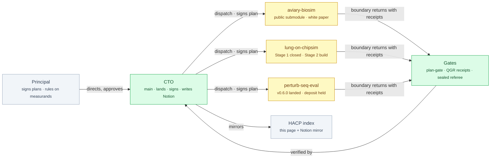

# bioFM — Index

<!-- HACP L0 · local source. The Notion row "bioFM — Index" (CTO-written) mirrors this file; edit here, never there. -->

| | |
|---|---|
| **Project** | `bioFM` — a coordination repo for three research workstreams run under the AI-RDLC lifecycle, plus one public submodule |
| **This page** | L0 — the project index. One screen. |
| **Alignment** | Each workstream builds under a hash-signed plan; every boundary is receipted. Divergences are recorded in each workstream's approval log, never patched over: lung-on-chipsim has 59 numbered revisions + 4 non-numbered principal/route rows (63 rows, counted 2026-09-29; 49 of 59 standing-delegation, 0 inferred) incl. two accepted gate failures; perturb-seq-eval's amendment 2 re-derived two estimators after a CTO re-check; aviary-biosim's plan was re-signed once (r2) after its referee contract changed. |
| **Protocol** | HACP (`REFERENCE-HACP.md`, shipped with the airdlc plugin) |
| **Public** | Repo is public. No page here names a sequence identifier, a chemical identifier, or a secret. |

## Index

| Tag | State | Count |
|---|---|---|
| [`§vision`](vision.md) | three workstreams, no PVR for perturb-seq-eval (requirements came from a review) | 3 |
| [`§design`](design.md) | A&Ds approved for all three; lung-on-chipsim's Stage 1 registered-report design written | 3 A&D + 1 paper design |
| [`§build`](build.md) | aviary-biosim F08 landed; white paper pushed (`c66e64c`), draft PR Aviary-BioSim#2, CTO A7 rigour review in progress; perturb-seq-eval v0.6.0 landed, deposit prepared and held; lung-on-chipsim Stage 1 closed and archived, Stage 2 build phase ruled 2026-10-04 (M1 input contracts on an unmerged branch) | 3 in flight |
| [`§eval`](eval.md) | aviary-biosim receipts `4217902` (F08) and `2a9b966` (white paper) verified; perturb-seq-eval v0.6.0 gates 4/5 PASS (H5 FAIL) with a result-review row, deposit-prep receipted; lung-on-chipsim final gate FAIL, no receipt, 0 results by design | 4 receipts, 1 result review, 1 closed without receipt |
| [`§risk`](risk.md) | evidence-integrity finding (seeded run state), unpinned prompts, held F31, unfrozen evaluator | 4 project-level |
| [`§decision`](decision.md) | 3 principal items open: the deposit go, D3 evidence `git_sha`, D18 frozen snapshot | 3 |

**TL;DR** — Three research workstreams run under one rule: no boundary is claimed without a receipt a third party can verify, and no plan runs unsigned. aviary-biosim's build landed and its white paper is a draft PR under the CTO's A7 rigour review (approved 2026-10-09); perturb-seq-eval's v0.6.0 result landed (4/5 pre-registered gates) and its deposit is prepared but held for the principal's explicit go; lung-on-chipsim closed Stage 1 at a failed final gate (record preserved on main) and is in its Stage 2 build phase, where what remains is human-written scientific input.

## Where it sits

*Green is the trust boundary: an agent's own report closes nothing; the CTO lands only what a receipt verifies, under a plan whose hash matches its signature.*

## Decisions taken

| Decision | Chosen | Alternatives considered | Why this one | Impact | Date |
|---|---|---|---|---|---|
| Plans are hash-signed and every revision is logged | `plan-gate sign/verify`; append-only approval log per workstream | Prose approval in chat | A plan that can change after approval certifies nothing | 55 logged revisions on lung-on-chipsim alone; two gate failures accepted rather than patched | 2026-09 |
| Content-guard scope is a decidable property, not a path list (E-23) | five named properties; unaccounted sites reported as a sum identity | a scope registry of files | a registry is the path allowlist that caused #412; 87% of shaped sites are structurally unmarkable | r2.49b to be re-signed; time box: one more revision after a gate-8 fail | 2026-09-28 |
| Entropy measurands re-derived for perturb-seq-eval | `ace_d` replaces softmax ACE_norm (range ≈[0.92,1]); unclipped ΔC | keep the pinned formulas | the pinned forms could not distinguish the hypotheses they scored | amendment 2 locked (`3bf2a9a`) | 2026-09-26 |
| White paper claims are traced by script | `paper/claims.yaml` + `claims.py` fail on any unmapped number | reviewer reads every number | the paper's thesis is that mechanisms report success while the property is absent; it must not do that itself | A7 runs before the CTO rigour review | 2026-09-25 |
| Input identifier published openly (F33) | accession + release + sequence sha256 in `paper/evidence/` + methods | hash only | a digest over an enumerable grammar is a lookup, not a redaction; the association is already public | confirmed by the principal | 2026-09-28 |
| lung-on-chipsim publishes as a Stage 1 registered report | methods + pre-registered analysis before results exist; short form written separately | conventional paper with a thin results section | the project has complete machinery and zero results by design (no agent writes a biological number) | draft gated behind gate 8 | 2026-09-26 |

## Decisions needed

- **perturb-seq-eval deposit** *(since 2026-10-08)* — prepared (`5407606`, nothing submitted); nothing reaches Zenodo/Figshare until the principal's explicit go. The S1 ruling (remove `llm_key_source` everywhere, amend the manifest hash) is applied first.
- **D3 — white-paper evidence `git_sha` predates script edits** *(since 2026-10-08)* — principal-owned finding from the white-paper gate.
- **D18 — no frozen snapshot of the white paper** *(since 2026-10-08)* — CTO prepares, principal decides.

## Sections

| Tag | Holds | State | Updated |
|---|---|---|---|
| [`§vision`](vision.md) | what is attempted and why now | current | 2026-09-28 |
| [`§design`](design.md) | A&Ds, the Stage 1 paper design, decisions with declined alternatives | current | 2026-09-28 |
| [`§build`](build.md) | phases, branches, in flight | 3 in flight | 2026-10-09 |
| [`§eval`](eval.md) | receipts, sealed suites, what is proven and what is blocked | current | 2026-10-09 |
| [`§risk`](risk.md) | known gaps and proxies | 4 open | 2026-09-28 |
| [`§decision`](decision.md) | what the principal owns | 3 open | 2026-10-09 |
| [`aviary-biosim (bioFM) — Index`](aviary-biosim/index.md) | subproject review index: the v2r loop, `BioSimEnv`, the white paper (bioFM-side documents) | landed; white paper in draft PR, A7 review in progress | 2026-10-09 |
| [`ChipSim (bioFM) — Index`](lung-on-chipsim/) | subproject review index for lung-on-chipsim | Stage 1 closed and archived (record on main); **Stage 2 build phase** — the Notion row is the source of truth for this subproject (principal, 2026-10-03) | 2026-10-04 |
