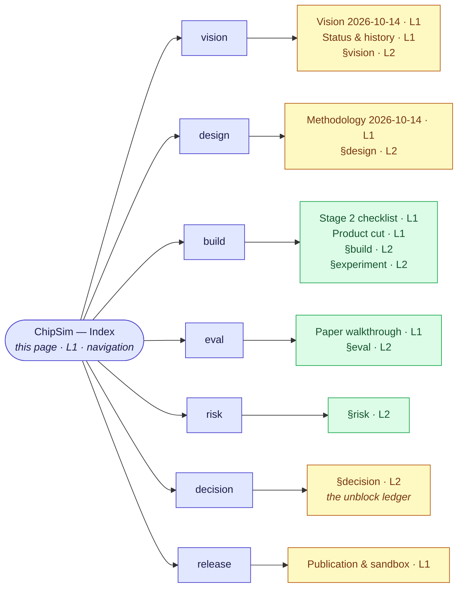

# ChipSim (bioFM) — Index

<!-- HACP L1 subproject index · Kind = Index · Indexed by "bioFM — Index".
     SOURCE OF TRUTH: the Notion row https://app.notion.com/p/b7c749bd250d83dab06201f85d61ee49
     (principal, 2026-10-03: Notion HACP is the SoT for human review and communication). This file
     mirrors it; notion-map.json records each page's URL and last sync.

     BEFORE EDITING THIS FILE OR ITS NOTION ROW, READ THE GOVERNANCE CONTRACT:
     https://app.notion.com/p/313fda9448094029904f344523d5bd01 — and ../../../CLAUDE.md §HACP.
     An index carries ENTRY POINTS ONLY. It is navigation, not administration: no status tables,
     no timelines, no decision history, no prose summaries of what a child page says. Content
     displaced from this page on 2026-10-14 lives in status-and-history.md. -->

> **This page is navigation only — the AIRDLC table index for `lung-on-chipsim`.**
> Every number, date, decision and open ask lives one click away, in the page that owns it.
> Start at [Status, timeline & decision history](status-and-history.md) for where things stand,
> or at [`§decision`](decision.md) for what is owed and by whom.

## AIRDLC index

| Phase | Entry | Layer | Holds | State |
|---|---|---|---|---|
| **vision** | [Vision 2026-10-14](vision-2026-10-14.md) | L1 | the principal's vision input, the objective it sets, the five deliverables | **current scope** · 2026-10-14 |
| | [Status, timeline & decision history](status-and-history.md) | L1 | where the project stands, the measured status table, the week 0–7 timeline, 19 decisions taken | **new** · 2026-10-14 |
| | [`§vision`](vision.md) | L2 | the PRD's one claim, the minimum viable chip, the three controls | current · 2026-09-28 |
| **design** | [Methodology 2026-10-14](methodology-2026-10-14.md) | L1 | the research analysis, the refuted device-loss term, the transportability finding, the data audit | **new** · 2026-10-14 |
| | [`§design`](design.md) | L2 | the A&D, the hash-locked decision record, four ADRs, eight divergences | current · 2026-09-28 |
| **build** | [Stage 2 kickoff checklist](stage2-kickoff-checklist.md) | L1 | the pre-conditions in satisfiable order, week 0 → week 7 | 3 of 36 ticked · 2026-10-04 |
| | [`§build`](build.md) | L2 | phases, where the code is, the human-owned ledger, what is in flight | renewed · 2026-10-04 |
| | [`§experiment`](experiment.md) | L2 | the M1 input contracts, what each validator refuses, what is still a human's to write | updated · 2026-10-08 |
| | [Product cut](../../../workstreams/lung-on-chipsim/qa/_adhoc/lung-on-chipsim-walkthrough-product.md) | L1 | the one-pager for the principal: first real artifact, where the work stops, the risk worth naming | current · 2026-09-29 |
| **eval** | [`§eval`](eval.md) | L2 | the measured suite, ten recorded gates, the pre-registered commitments, the power simulations | 2026-10-03 |
| | [Paper walkthrough](../../../workstreams/_adhoc/lung-on-chipsim-paper.md) | L1 | the Stage 1 registered report read as a paper: the report that measured its own approval log | current · 2026-10-02 |
| **risk** | [`§risk`](risk.md) | L2 | twelve gaps and the recurring defect family | 2026-10-03 |
| **decision** | [`§decision`](decision.md) | L2 | **the build-phase unblock ledger** — what is owed, by whom, with acceptance checks | renewed · 2026-10-04 |
| **release** | [Publication & sandbox](publication-and-sandbox.md) | L1 | the publication objective, deliverables D1–D5, the access-portal contract | **new** · 2026-10-14 |

The **ChipSim index** database on the Notion row is the canonical membership surface: it carries
each row's Kind, Section, Granularity, owner and review cadence, and it is what a reviewer filters.
This table lists every **live** entry, ordered for reading; superseded rows and L2 detail reached
only by maintenance stay in the database. One row is deliberately absent here: the Stage 1 draft
materials (L2, superseded, preserved on `main`). Floor-to-Notion URLs and sync dates:
[`notion-map.json`](notion-map.json).
