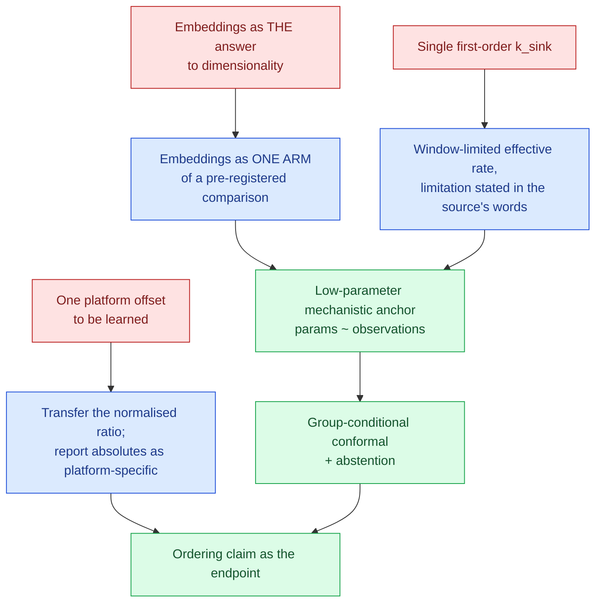

# Methodology decision 2026-10-14 — what the literature says to build, and what it says not to

<!-- HACP L1 · Kind = Decision · Section = design · Indexed by "ChipSim (bioFM) — Index".
     SOURCE OF TRUTH: the Notion row. This file mirrors it; see notion-map.json.
     Evidence base: a 154-paper Undermind deep search plus four full texts read end to end.
     SUPERSEDES the assumption, implicit in the 2026-10-14 vision input, that pretrained
     embeddings are themselves the answer to the dimensionality problem. -->

**Kind:** Decision · **Layer:** L1 · **Holds:** the methodology the evidence supports, the two design changes it forces, and the data-source audit · **Reaches:** [the vision](vision-2026-10-14.md), [§experiment](experiment.md), the experiment-setup worksheet

## TL;DR — the research contradicted the brief, usefully

The vision input asked for a methodology to "overcome the dimensionality curse using trainable and
opensource embeddings". The literature does not support that as the primary lever, and saying so
is the most valuable thing this analysis produced. Three findings, in descending order of how much
they change the build:

1. **Pretrained molecular embeddings are not a reliable win in the low-data regime.** They are a
   candidate featurizer to be benchmarked against descriptors and fingerprints, not a substitute
   for them. Building on the assumption that they are would have been a silent methodological bet.
2. **A primary source explicitly refutes the project's own `k_sink` parameterisation.** The single
   first-order loss constant already in the ChipSim design is contradicted, in the authors' own
   words, by the paper that measured the phenomenon. This is a model change, not a tuning note.
3. **There is no single cross-platform offset to learn.** The transferable quantity is a
   *normalised, within-platform ratio*, not an absolute permeability — and the measured
   platform-to-platform ratio varies about 40-fold across three compounds on one pair of platforms.

The dimensionality problem is therefore attacked by **keeping the free-parameter count near the
observation count** — a low-parameter mechanistic anchor with chemistry informing selected
parameters or residuals — not by a larger featurizer.

## Finding 1 — embeddings are a hypothesis, not the method

| Evidence | What it says |
|---|---|
| A benchmark of pretrained molecular embedding models | finds little consistent gain over classical fingerprints across downstream tasks |
| A multitask PAMPA permeability study | finds expert descriptors competitive or better on the small-data permeability task closest to ours |
| An early low-data pretraining result | does report gains, which is why this is a benchmark question and not a settled one |
| Domain adaptation of molecular transformers | helps, but the evidence concerns conventional ADME assays, not transfer to lung barriers |

**Decision.** Embeddings enter as one arm of a pre-registered comparison against descriptors and
fingerprints, on our own calibration set, with the comparison's outcome reported whichever way it
falls. They do not enter as the architecture. The honest framing for the paper is that we tested
whether transfer helps at this n, not that we assumed it.

## Finding 2 — the `k_sink` single-constant model is refuted by its own source

This is the sharpest result. The project's two-compartment design carries one first-order sink
rate constant for loss to the device. The paper that simulated exactly this, on a lung airway
chip, concludes the opposite, verbatim:

> "Thus, applying a single constant to describe drug loss in an Organ Chip will not capture these
> dynamic concentration distributions and may inaccurately describe the dosing window."

It reports loss in **two phases** — "the first phase is dominated by adsorption to the channel
wall and the second is dominated by diffusion through bulk PDMS" — with saturation: "the drug
approaches a saturation limit near the PDMS wall."

It also reports something that *reduces* the expected loss and must not be missed: the fitted
effective partition range in the lined chip was far below the compound's bulk hydrophobicity,
because "the channels of the human Lung Airway Chip are coated with extracellular matrix and cells
that effectively reduce the hydrophobicity and decrease drug adsorption." A bare-PDMS partition
coefficient would overstate loss in a cellularised chip.

**Decision, for the principal.** Three options, and the `k_sink` prior stays deliberately empty
until one is chosen:

| Option | What it costs | What it buys |
|---|---|---|
| **A. Two-phase sink** (adsorption then bulk diffusion) | two more parameters, against a calibration set of tens | fidelity to the cited mechanism |
| **B. Keep one constant, report it as window-limited** | a stated limitation in the paper | parameter parsimony, which at this n is the binding constraint |
| **C. Pre-equilibrate the device and treat loss as an offset** | a protocol change, not a model change | removes the term from the inference entirely |

**Recommended: B for the first publication, with the limitation stated in the authors' own
quoted words, and C as the protocol recommendation.** Option A adds parameters in exactly the
regime where parameter count is the problem. The validation-barrier thesis is better served by a
model that declares its misspecification than by one that hides it in more terms.

## Finding 3 — transportability transfers ratios, not values

The cross-platform literature is blunt about the naive approach. On comparing a static insert
assay with a perfused chip, verbatim:

> "However, a direct comparison between the permeability results obtained in transwells and
> microfluidic devices is not appropriate. Instead, it is more appropriate to compare normalized
> permeability results for each system."

The reason is structural, not statistical: the chip value is estimated at **steady flux** while
the insert's flux decays as the compartments equilibrate, and the two permeability formulas differ
— the chip's includes the flow rate, the insert's does not. The quantity that does travel is the
**with-cells over without-cells ratio** computed inside each platform.

How far an absolute value fails to travel is now measurable. On one small-airway chip compared
against a published ex-vivo rat lung, the chip-to-animal ratio across three compounds was
approximately 1.24, 0.125 and 4.98 — a **40-fold spread** in what a single "platform correction
factor" would have to be.

| Quantity | Transfers? |
|---|---|
| absolute apparent permeability | **no** — platform-specific by construction |
| with-cells / without-cells ratio within a platform | **yes** — this is the designed transfer target |
| rank ordering of compounds within a platform | **yes, and it is what the project's claim already tests** |
| a single additive or multiplicative platform offset | **no** — refuted by the 40-fold spread |

**Decision.** The claim under test stays an **ordering** claim, which this evidence vindicates:
rank correlation is the endpoint that survives the platform problem. Any absolute exposure the
sandbox reports is labelled platform-specific and carries the device it was conditioned on.

## Uncertainty — the method, and its honest limit

Conformal prediction gives finite-sample coverage under exchangeability without distributional
assumptions, which is why it is the right family here. Two caveats from the same literature
decide the design:

- **Tiny calibration sets give coarse intervals.** The guarantee holds; the interval is wide.
  That is the correct trade and must be reported, not narrowed.
- **Subgroup guarantees need subgroup data.** Mondrian or group-conditional conformal prediction
  gives per-group coverage *only if each group has adequate calibration points*. The project's
  sealed allocation already targets about 20 conformal points per P-gp group, which is the
  minimum this requires and the reason that allocation was chosen.

Supporting methods adopted: jackknife+ style predictive inference for the small-n regression
case, adaptive conformal regression with rescaled scores where the error scale varies with the
input, applicability-domain filtering as the basis for **abstention**, and Bayesian active
learning over a pretrained encoder for choosing the next wet experiments. The interpretability
payload already implemented in `chipsim.sandbox.interpretability` carries exactly the fields these
methods make load-bearing: the nominal level, the calibration count, the subgroup, and whether the
guarantee is conditional or marginal.

## The real bottleneck, confirmed

The deep search's own summary states it: *"The limiting evidence is qualification for a defined
context of use and reproducible cross-laboratory performance."* The regulatory-and-industry
workshop literature on adopting complex in-vitro models says the same. This is the validation
barrier the vision input names, and it is an evidence-and-qualification problem rather than a
modelling-capacity problem. It is the paper's thesis and the reason the deliverable is a
*calibrated, abstaining* surrogate rather than an accurate one.

## Data-source audit — can the sandbox be built?

**Yes, with one honest hole.**

| Source | Use | Status |
|---|---|---|
| Therapeutics Data Commons | pretraining and benchmark ADME/permeability tasks | open, redistributable; the pretraining substrate |
| ChEMBL | bioactivity and target data | open under a permissive licence; already in the project's source register |
| DrugBank 4.2 public snapshot | compound identity, drug-transporter edges | already pinned, DVC-tracked, non-commercial terms recorded |
| Small-airway MPS permeability (full text read) | **3 on-chip Papp values, now cited** with verbatim quotes | the T21 yardstick and the α prior |
| Transwell-versus-microfluidic tracer study (full text read) | the cross-platform ratio method; tracer permeabilities | read; its absolute values are read off a figure, so they are approximate and labelled as such |
| PDMS chip drug-concentration simulation (full text read) | the k_sink finding; PDMS diffusivity; effective partition | read; it is also the source that refutes the single-constant model |
| Microphysiology Systems Database / organ-chip databases | locating chip evidence | exist; useful for discovery, not a curated lung transport set |
| Lung epithelial line transport studies (Calu-3, 3D airway) | context and contrast | available; static platforms, so excluded from the chip yardstick by Finding 3 |

**The hole: compound identity.** The canonical InChIKey is this project's join key and the key the
sealed allocation is built on, and PubChem is unreachable from this container (403 to CONNECT,
with no alternative path found). The compounds above are therefore identified by **name only**,
which is enough for this document and not enough for `configs/`: the T21 loader requires a
canonical InChIKey per entry and will refuse the file without one. That is the single remaining
data blocker, and it is an access problem, not a scientific one.

**No licence term was assumed.** Each source's reuse terms are recorded per record in the project's
source-provenance file, and a term marked as needing human confirmation has not been checked.

## What changed in the build as a result

## Open, and whose

| # | Item | Owner |
|---|---|---|
| M1 | Choose option A, B or C for the device-loss term; the `k_sink` prior stays empty until then | principal |
| M2 | Ratify the proposed θ file: 3 cited, 3 assumed with stated widths | principal |
| M3 | Resolve compound identity (PubChem access, or supply the InChIKeys) so T21 can be written | principal or an access change |
| M4 | Pick one coating from the source's own disjunction, since it names two | principal |
| M5 | Run the embeddings-versus-descriptors comparison once a calibration set exists | agent |

Back to the [index](index.md).
