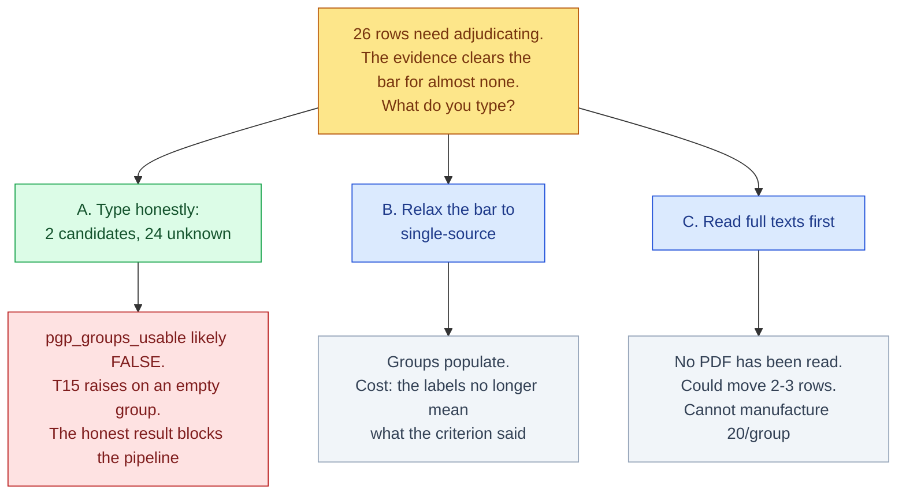

# The 26 P-gp verdicts — everything needed to type them, and the finding that changes what they mean

<!-- HACP L1 · Kind = Decision · Section = decision · Indexed by "ChipSim (bioFM) — Index".
     SOURCE OF TRUTH: the Notion row; this file mirrors it. See notion-map.json.
     Built with .claude/skills/hacp-decision-surface.
     PUBLIC-REPO DISCIPLINE: compound names and public DOIs appear here because the surface is
     useless without them. NO structure identifier appears on this page by design — no InChIKey,
     no accession, and therefore no (name, structure) pairing is created anywhere in this file. -->

**Kind:** Decision · **Layer:** L1 · **Pinned:** bioFM `main` `e264484` (pushed) · **Stale by construction — re-derive at decision time**

> **This is a HUMAN-OWNED task and it cannot be delegated.** `build-plan.md` T14, verbatim: *"This is
> the task that makes the M5 grouping variable trustworthy, and it **cannot be delegated** — a
> fabricated DOI here would corrupt the coverage claim invisibly."* The CTO assembled evidence. **No
> verdict on this page is a verdict.** Every recommendation is a reading of cited sources that you are
> free to reject, and the column that matters is the one you type.

## The junction

**Everything mechanical is done. The protection is committed, the gate is green, and `main` is pushed.
What remains is 26 rows of human judgement — and the evidence says almost none of them can be resolved.**

*The red branch is the honest answer and it is also the one that stops the pipeline. That tension is
the decision, and it should not be resolved by quietly loosening a criterion.*

## Read this before you type a single row

The repository knowledge graph is dated **2026-09-18** at `81bee6d5`, **five weeks stale** against
`e264484`. It was not used. **No figure on this page comes from it.**

**THE GROUPING VARIABLE MAY BE BIOLOGICALLY INAPT FOR THIS TISSUE.** Four independent sources concur
that P-gp is largely absent from human airway epithelium, which is the bar *you* set at
`build-plan.md:1576` — *"Delete ONLY on positive evidence of absence from airway epithelium. Silence is
not evidence."* UniProt silence did not meet it. This does:

| fact | source |
|---|---|
| P-gp **absent in all of 8 human lung epithelial models except Calu-3**; functional activity only in Calu-3 at air-liquid interface | Simon 2025, `10.1016/j.ejps.2025.107333` |
| *"P-gp was absent in NHBE cells"* (primary human bronchial), *"in line with observed low gene expression in human lung tissue"* | Hutter 2011, `10.1183/13993003/erj.38.suppl_55.p843` |
| Even in Calu-3, data *"do not support an exclusive role of MDR1"* in digoxin efflux | Hutter 2014, `10.1016/j.ejpb.2013.06.010` |
| In-vitro respiratory models possess **"nominal"** functional P-gp activity (title claim) | Mádlová 2009, `10.1211/jpp.61.03.0003` |

**AND WHERE IT IS PRESENT, IT FACES THE WRONG WAY.** In Calu-3 — the *only* airway model with
functional P-gp — MDR1-Pgp localises to the **basolateral** membrane by Western blot and confocal, so
it pumps **absorptively** rather than effluxing apically (Florea 2001, `10.1038/sj.bjp.0704390`).
**Efflux-direction reasoning imported from intestinal or blood-brain-barrier models does not transfer.**

**THE TRANSPORTER THAT ACTUALLY GOVERNS THIS CLASS HERE IS OCT1.** β2-agonists are *"specific substrates
and inhibitors of OCT1 in human respiratory epithelial cells"* (Salomon 2015, `10.1021/mp500854e`);
ipratropium's measured efflux ratio >4 is attributed to an apical OCT, with absorption *"primarily
governed by paracellular passive diffusion"* (Panduga 2017, `10.1016/j.ijpharm.2017.08.112`). More than
half the roster are organic cations.

**THE ONE SOURCE SUPPORTING A P-gp AXIS FOR INHALED DRUGS IS A PREDICTION.** Price 2017
(`10.1007/s11095-017-2220-5`): eight marketed inhaled drugs were ***predicted*** to display P-gp
dependent pulmonary disposition, by QSAR. The sibling workstream's own failure mode **F1** is *"a
predicted number read as a measured one."*

**You already ruled on this** (approvals row 48): keep the pre-registered axis, carry the finding as a
cited limitation, and accept that **the coverage claim will be about the method, not about lung P-gp
biology.** This page does not re-open that. It makes sure you type with it in view.

## The vocabulary, and the two mechanical facts that constrain you

- Allowed values are exactly **`yes` / `no` / `unknown`**. Anything else is refused.
- **`unknown` requires no DOI.** `yes` and `no` do (`CITED_LABELS = {yes, no}`).
- **Partial adjudication is refused** — all 26 rows or none.
- **`unknown` excludes a compound from BOTH calibration groups.** It is the correct answer for a
  genuinely uncertain compound and T14 says so: *"Leave genuinely uncertain compounds as the explicit
  string `unknown`; they are excluded from both calibration groups rather than guessed into one."*
- **Do not type a compound name into any cell.** `adjudicated_by` takes your name; `evidence_doi` takes
  a DOI. T14 r2.19 records that **no column check can catch a name typed into a legitimate column** —
  it is an instruction, not an enforced guard. Work from the identifier column; the worksheet shows you
  the name beside it.
- **Type into the untracked working copy**, then publish with `chipsim adjudication-export`. Never
  hand-edit the tracked file: a blank re-export over a filled tracked file is **refused**, which is the
  protection working. The measured failure it guards against left 0 of 24 verdicts and *returned 24*.

## The evidence, ranked — rows needing judgement first

**Criterion (yours, recorded): multi-source concurrence, platform-agnostic.** Two or more independent
peer-reviewed sources concurring on the compound's **own substrate status**. One source, or a conflict,
means `unknown`. Efflux ratio alone is not enough: it is platform-dependent (Volpe 2022 — 50% of known
substrates had their highest ER in MDCK-MDR1, 81% their lowest in Caco-2) and confounded by paracellular
transport, an unaccounted basolateral influx transporter, and pH (Kotze 2024).

### Needs your judgement — 3 rows

| compound | what the sources actually say | sources | the call you are making |
|---|---|---|---|
| **Flunisolide** | Apical→basolateral, **ATP-dependent** transport in Calu-3; **basolateral→apical in MDR1-transfected LLC-MDR1** (canonical direction); **no polarisation in untransfected LLC-PK1**; abolished by low temperature, by 2-deoxy-D-glucose/azide, and by **three specific P-gp inhibitors** (verapamil, SDZ PSC 833, LY335979) with no TEER loss; MDR1-Pgp localised basolaterally by **two methods**; mass spec confirms it crosses unmetabolised | Florea 2001, `10.1038/sj.bjp.0704390` | **ONE paper, but with a transfected positive control, a negative control line, three independent inhibitors and two localisation methods.** Does that satisfy a *two-source* bar? Strictly no. Substantively it is the strongest determination on the roster. **Your call, and it is the one row where the criterion and the evidence genuinely pull apart.** |
| **Budesonide** | (a) Caco-2 bidirectional corticosteroid study, budesonide among the inhaled set; (b) **in vivo**: the P-gp inhibitor zosuquidar raised fetal exposure **0.31 → 0.59, P<0.01**, and fetus/plasma free ratio 0.38–0.42 was significantly below 1 — *"placental P-gp may be involved in reducing the fetal exposure"* | Crowe 2012, `10.1016/j.taap.2012.03.008`; Zaidi 2019, `10.1208/s12248-019-0313-2` | **The only row with two concurring sources** — and **both are off-target**: one is intestine, one is **mouse placenta**. Neither is a human airway model. Two sources, wrong tissue. |
| **Fluticasone propionate** | **The two sources disagree.** (a) Caco-2 efflux ratio **2.3**, above the conventional ER>2 threshold; (b) the same in vivo study found fetus/plasma free ratio **0.87** — *not* restricted, and significantly higher than budesonide's | Crowe 2012; Zaidi 2019 | **A genuine conflict, so `unknown` by the criterion.** Worth typing deliberately rather than by default: this is a disagreement between in vitro and in vivo, not missing data. |

### Mechanical — searched, nothing found, `unknown` is the only honest value

Each was searched in **minimal two-term form** (see the instrument note below). A hit count is not a
determination: several return many papers where the compound merely appears beside P-gp — a DDI
cocktail, an induction study, a co-administered drug.

| compound | query | hits | why it is still `unknown` |
|---|---|---|---|
| Beclomethasone | in Crowe 2012 | — | Caco-2 ER **3.3**, the highest inhaled steroid measured — but **one source only** |
| Triamcinolone | — | — | **not among** the steroids Crowe assayed; no other determination found |
| Salbutamol, Formoterol, Salmeterol | grouped | 9 | named as **OCT1** substrates, not P-gp (Salomon 2015) |
| Ipratropium bromide | `ipratropium P-glycoprotein` | **0** | measured efflux >4 exists but is attributed to **OCT**, not P-gp |
| Terbutaline | — | — | classified among **paracellularly** transported compounds in an intestinal model (Takenaka 2014, `10.1124/dmd.114.059493`) |
| Montelukast | `montelukast P-glycoprotein` | 13 | in a validated DDI cocktail it is the **CYP2C8** probe while **digoxin** is the P-gp probe |
| Theophylline | `theophylline P-glycoprotein` | 40 | large literature, dominated by **CYP1A2 metabolism**; no substrate determination isolated |
| Epinephrine | `epinephrine P-glycoprotein` | 16 | endogenous catecholamine; literature is **OCT/NET/VMAT** |
| Nedocromil | `nedocromil transporter` | 33 | hits are not P-gp substrate determinations |
| Tiotropium | `tiotropium P-glycoprotein` | **0** | genuine zero |
| Aclidinium | `aclidinium transporter` | 2 | neither is a substrate determination |
| Roflumilast | `roflumilast P-glycoprotein` | 3 | too few for concurrence |
| Clenbuterol | `clenbuterol P-glycoprotein` | 2 | same |
| Ibudilast | `ibudilast P-glycoprotein` | **0** | genuine zero |
| Amlexanox | `amlexanox P-glycoprotein` | **0** | genuine zero |
| Indacaterol, Procaterol, Pirbuterol, Bitolterol, Isoetarine | grouped | **2 total** | effectively no literature across all five |

### A trap worth naming

**Crowe 2012 found that inhaled corticosteroids *induce* P-gp expression 1.6–2×.** Induction is **not**
substrate status. Anyone skimming for "interacts with P-gp" would collapse the two and produce a false
`yes` on four roster compounds.

## What this means arithmetically, before you type

`pgp_groups_usable` is `counts["yes"] > 0 AND counts["no"] > 0`. On the evidence above, the maximum
defensible `yes` count is **2** (flunisolide, budesonide) and **no row supports a `no` at all** — no
source states any roster compound is *not* a P-gp substrate to the two-source standard.

**So honest verdicts most likely give `yes ≥ 1, no = 0` → `pgp_groups_usable` FALSE, and T15 raises on
an empty group.** You should know that now rather than discover it after typing. **It is not a reason to
invent a `no`.**

Also note the guard's own weakness: `> 0` would certify "usable" on **groups of one**, against
ADR-0002's ~20 points/group and the ≥30-point veto. That is a bare floor in the flag that certifies
your work, and it is recorded (approvals row 48 discussion) rather than silently relied on.

## RATIFICATION SHEET — all 26 in worksheet row order, for accept-or-override

**This is a recommendation column, not a verdict column.** Nothing here has been written to any file.
The tracked projection remains blank in all four human-owned columns, verified at the time of writing.
Accept a row, override it, or ask for the full text behind it.

| # | compound | CTO recommendation | basis, in one line |
|---|---|---|---|
| 1 | Aclidinium | `unknown` | searched; no substrate determination found |
| 2 | Formoterol | `unknown` | named as an **OCT1** substrate, not P-gp |
| 3 | Procaterol | `unknown` | effectively no literature |
| 4 | Bitolterol | `unknown` | effectively no literature |
| 5 | Triamcinolone | `unknown` | **not** among the corticosteroids Crowe 2012 assayed |
| 6 | Salmeterol | `unknown` | OCT1, not P-gp |
| 7 | Isoetarine | `unknown` | no literature |
| **8** | **Beclomethasone** | **`yes`** — RULED 2026-10-26 | Caco-2 ER **3.3**, highest inhaled steroid measured. Admitted by the AMENDED criterion: Crowe 2012 is a **60-citation** single source. Assay is on the **dipropionate** |
| 9 | Dyphylline | `unknown` | no determination found |
| 10 | Tiotropium | `unknown` | **0 hits** at minimal query |
| 11 | Roflumilast | `unknown` | 3 hits, no concurrence |
| 12 | Salbutamol | `unknown` | OCT1, not P-gp |
| 13 | Ipratropium bromide | `unknown` | efflux ratio >4 measured, attributed to an apical **OCT** |
| 14 | Indacaterol | `unknown` | effectively no literature |
| 15 | Nedocromil | `unknown` | 33 hits, none a substrate determination |
| 16 | Amlexanox | `unknown` | **0 hits** at minimal query |
| 17 | Clenbuterol | `unknown` | 2 hits |
| 18 | Montelukast | `unknown` | it is the **CYP2C8** probe in a validated cocktail; digoxin is the P-gp probe |
| 19 | Epinephrine | `unknown` | endogenous catecholamine; OCT/NET/VMAT literature |
| **20** | **Budesonide** | **`yes`** — RULED 2026-10-26 | two concurring sources, **both off-tissue** (Caco-2 intestine; mouse placenta). Accepted on the platform-agnostic criterion, tissue limitation recorded |
| 21 | Pirbuterol | `unknown` | effectively no literature |
| **22** | **Fluticasone propionate** | **`unknown`** — RULED 2026-10-26, **as an OVERRIDE of the amended rule** | The amended rule points to `yes` (Crowe outcites Zaidi 20:1; ER 2.3 above threshold). Held `unknown` because the in-vivo result **contradicts** it — fetus/plasma 0.87, not restricted, significantly higher than budesonide's 0.38 in the same experiment |
| **23** | **Flunisolide** | **`yes`** — RULED 2026-10-26 | ONE paper, accepted because its **internal replication** satisfies the bar: transfected +ve control in the canonical direction, untransfected −ve control, three specific inhibitors, two localisation methods, mass spec |
| 24 | Terbutaline | `unknown` | classed among **paracellularly** transported compounds in an intestinal model |
| 25 | Theophylline | `unknown` | large literature, dominated by CYP1A2 metabolism |
| 26 | Ibudilast | `unknown` | **0 hits** at minimal query |

### ADJUDICATED 2026-10-26 — final distribution: `yes` = 3, `no` = 0, `unknown` = 23

**THE CRITERION WAS AMENDED MID-ADJUDICATION**, in the principal's words: *"in general, resolve to the
more well-cited source. adjust criteria such that 1 source that's well-cited can be accepted as well."*
This supersedes the 2026-10-23 multi-source bar in two respects — a conflict resolves to the
better-cited source, and a single **well-cited** source can carry a verdict. Citation counts were then
**measured**, because "well-cited" had become load-bearing: **Crowe 2012 = 60 citations (4.1/yr);
Zaidi 2019 = 3 (0.4/yr)** — a 20:1 ratio.

**The amendment flipped a row nobody had asked about, and it was put back to the principal rather than
applied silently.** Row 8 was `unknown` *solely* because Crowe was a single source; a 60-citation single
source is precisely what the amendment admits. Ruled `yes`, on the stated ground that applying a
criterion where it is inconvenient as well as where it is convenient is what keeps it a criterion.

**And the amendment pointed the opposite way on row 22 from the principal's own instruction.** Crowe
outcites Zaidi 20:1 and gives fluticasone ER 2.3, above threshold — the mechanical rule says `yes`. The
principal had said `unknown`. The tension was surfaced rather than resolved quietly, and `unknown`
stands **as an override of the amended rule, not an application of it.** Both now sit side by side in
the record, which is the only way a later reader can tell which did the work.

**WHAT THE AMENDMENT DOES NOT FIX.** `pgp_groups_usable` needs `yes > 0 AND no > 0`. Loosening the
`yes` bar took `yes` from 2 to 3 and left **`no` at zero**. Crowe's only sub-threshold compounds
(hydrocortisone, aldosterone) are not on this roster, and its conclusion about inhaled corticosteroids
is **comparative**, not a per-compound `no`. **The flag returns false and T15 raises on an empty
group** — the measured outcome of this literature, consistent with the aptness finding, and **not** a
reason to invent a `no`.

**Nothing on this page has been written to any file.** The tracked projection remains blank in all four
human-owned columns. T14's rule holds: the determinations are the principal's, and so is the entry.

## Options

| option | does | rules out | then what |
|---|---|---|---|
| **A — type honestly: flunisolide + budesonide as you judge them, the rest `unknown`** ★ | Produces the adjudication the evidence supports, with every `yes` carrying a real DOI | Rules out a populated contrast group, so coverage on this axis probably cannot be computed; `pgp_groups_usable` false | Record the blocked group as a **result** — the PoC reports that the pre-registered axis could not be populated from the literature, with the aptness finding as the reason |
| **B — relax the bar to single-source concurrence** | Admits beclomethasone (ER 3.3) and flunisolide, giving more `yes` rows | Rules out the criterion you ruled hours ago, and the labels stop meaning what the methods section will say they mean. Still yields **no `no` group** — so it probably does not even fix the arithmetic | A dated amendment to the criterion, and a methods section that states the weaker bar |
| **C — read the full texts first, then type** | No PDF has been read anywhere in this ledger; every row rests on titles, abstracts and MeSH. `read_pdfs` is available and could move 2–3 rows | Rules out typing today; costs CTO tokens and your time | I read Crowe 2012, Zaidi 2019 and Florea 2001 in full, re-rank, and you type against a stronger ledger |
| **D — change the axis to OCT1** | The biologically apt variable for this tissue, with evidence already cited | Changes a **pre-registered** grouping variable, and needs a second 26-row adjudication | A dated design correction; row 48 already declined this |

★ **Recommended: A, with C first if you want the two candidate rows firmer.** A is the only option that
leaves the labels meaning what the criterion says. **The blocked group is a finding, not a failure** —
"the pre-registered axis could not be populated from the literature, and here is why" is a publishable
result for a PoC whose stated goal is to show the method recovers known results.

## Gaps, stated rather than filled

- **No full-text PDF was read.** Every row rests on titles, abstracts and MeSH.
- **Coverage is PubMed- and Undermind-mediated.** A determination in a paper's body text, a regulatory
  dossier or a vendor datasheet would not surface here.
- **Budesonide's two sources are both off-target tissue** (intestine, mouse placenta). Treated as
  concurring on the molecule; neither speaks to airway epithelium.
- **No `no` is supported anywhere.** Absence of a P-gp finding is not evidence of non-substrate status —
  the same epistemics as the `unknown`/unassessed distinction below.
- **INSTRUMENT DEFECT, the CTO's, found mid-assembly and recorded because it nearly corrupted this
  page.** The PubMed connector **ANDs every term**. An over-specified montelukast query returned **zero
  twice**; the minimal two-term form returns **13**. A zero from a wrong query is indistinguishable from
  a zero in the data — the same mechanism as instance 11 in the ratified methods note, committed inside
  the instrument assembling the evidence. **Every zero on this page was re-run in minimal form before
  being written**, and the queries are published above so you can re-run them rather than trust them.
- **`unknown` ≠ unassessed.** `unknown` is a finding reached *after* searching. All 26 are searched;
  the queries and counts are published so that claim is checkable.

---

**Provenance.** Built with `.claude/skills/hacp-decision-surface`. Evidence assembled by the CTO
in-session via the PubMed and Undermind connectors (sub-agents were probed and have **neither**, and
the permitted researcher type correctly refused to substitute a search engine). Every figure measured at
`e264484`. The knowledge graph was checked for freshness, found five weeks stale, and not used. Ledger:
approvals rows 48–50. **No verdict on this page is a verdict — the principal is the author of record.**
