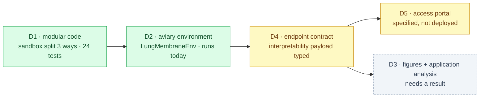

# Publication objective, deliverables and the access portal

<!-- HACP L1 · Kind = Decision · Section = release · Indexed by "ChipSim (bioFM) — Index".
     SOURCE OF TRUTH: the Notion row. This file mirrors it; see notion-map.json.
     Set by the 2026-10-14 vision input; the methodology it rests on is in
     methodology-2026-10-14.md. SUPERSEDES the Stage 1 registered-report framing as the
     project's publication target. -->

**Kind:** Decision · **Layer:** L1 · **Holds:** what is being published and claimed, the five deliverables with their done-conditions, and the access-portal contract · **Reaches:** [the vision](vision-2026-10-14.md), [the methodology](methodology-2026-10-14.md), [§experiment](experiment.md)

## 1 · The objective, in one sentence

**Publish a calibrated, abstaining surrogate for on-chip drug exposure, and ship the sandbox that
lets a referee check it** — claiming not accuracy but *decision usefulness*: that a model which
reports honest per-subgroup intervals and declines out-of-domain inputs can shrink a wet-lab
validation queue by a measurable amount.

## 2 · The claim, and why it is publishable before the model is accurate

The scientific bottleneck is validation, not modelling capacity. A model that cannot say when it
is wrong does not displace a wet experiment; it adds a number somebody must now also check. The
qualification literature on complex in-vitro models says the limiting evidence is demonstrated
predictive validity for a *defined context of use* plus reproducible cross-laboratory performance.

So the publishable unit is the **pairing** of three things, none of which is novel alone:

| Component | Why it is in the claim |
|---|---|
| a low-parameter mechanistic transport anchor | keeps free parameters near the observation count, which is the actual answer to the dimensionality problem |
| distribution-free, group-conditional intervals | makes the output a decision object with a finite-sample guarantee rather than a point estimate |
| an explicit abstention rule | a system that never declines has been fitted, not calibrated |

**What is NOT claimed.** That the simulation is accurate. That embeddings beat descriptors — that
is tested, and reported whichever way it falls. That results transfer between platforms: the
evidence says absolute permeabilities do not, and the claim is deliberately an *ordering* claim
for that reason.

**The negative result is publishable too.** If the surrogate holds on ordering but fails coverage,
the honest finding is "a ranker, not a validator", and it is a real contribution to the
qualification question. That was already the project's §5E position and the new evidence
strengthens it.

## 3 · Venue

**Decided: name the venue on the draft, not now.** The methodology analysis changed the claim
once already; committing a venue before the first result would be choosing a format for a claim
not yet fixed. The shortlist follows from where the cited evidence lives: journals publishing
organ-on-chip modelling and simulation, pharmacometrics and systems pharmacology, and
cheminformatics venues that take open-sandbox software papers. A software-and-data paper is the
likelier fit than a pure methods paper, because the sandbox is half the contribution.

## 4 · The five deliverables

### D1 · Clean, modular code — **built**

`chipsim.sandbox` is three modules that answer different questions, deliberately separable:
`readiness` (may a number be produced at all?), `interpretability` (what must accompany one?),
and `env` (the agent-facing environment). The first two are importable and testable without
`fhaviary`, which is an optional extra rather than a runtime dependency, so the data spine still
works on a machine that has never heard of aviary.

**Done when:** each module has tests that can fail; `ruff`, `ty` and the suite green in CI.
**Status: met.** 24 sandbox tests, 471 in the offline suite, lint and types clean.

### D2 · The aviary environment — **built and running**

`LungMembraneEnv` conforms to the same `Environment` contract as `BioSimEnv` in the Aviary-BioSim
repository: `reset` returns observations and tools built from function docstrings, `step` handles
invalid tool calls through `filter_invalid_tool_calls`, and `export_frame` reports state. Three of
that environment's decisions are carried over deliberately, each load-bearing:

- **Reward is 0.0 and the docstring says why.** aviary carries a reward because it is an RL gym;
  this is tool-mediated experiment design, and inventing a scalar would be a fabricated signal.
- **The refusal happens before the tool runs and outside the error handler**, so a readiness
  refusal cannot be reported as a tool failure and carried on from.
- **No tool writes any artifact.** Every input the environment depends on is a human-owned claim.

**The environment's first behaviour is an honest refusal.** With the human-owned inputs absent,
`predict_exposure` returns a structured abstention naming each blocking artifact, its plan task
and its owner, instead of a number. That is not a stub — it is the validation-barrier thesis made
executable, and an agent exploring the environment learns what stands between it and a prediction.
A test asserts that even a *ready* sandbox refuses to fabricate: the surrogate is the next thing
to build, and a shaped placeholder would be indistinguishable from a real number downstream.

**Done when:** an agent can drive it end to end. **Status: met**, verified by running reset, an
abstention, the contract tool, an unknown tool and the frame export.

### D3 · Supplementary context — **blocked on a result, by design**

Figures and an application analysis showing what the method would do to a real screening queue:
how many wet runs it would defer, how many it would decline to judge, and what the abstention rate
costs. This needs a calibration set, so it waits on M0b. Writing it now would mean drawing figures
from numbers that do not exist.

### D4 · A working endpoint — **contract typed, server not written**

The response contract is implemented as typed structures that **cannot be constructed incomplete**:

| Guarantee | How it is enforced |
|---|---|
| a cited parameter carries a resolvable citation | constructor raises without one |
| an interval states its calibration count | an interval with zero calibration points is refused outright |
| a marginal interval cannot pose as a conditional one | `group_conditional` is required, and the generated caveat says "MARGINAL" when false |
| a point cannot fall outside its own interval | constructor raises |
| the caveat and the assumed-parameter list reach the wire | materialised in `as_dict`, so a client that forgot to call them still publishes them |
| an abstention carries its remedy | `what_would_change_it` is required |

**Done when:** a request returns the payload above over HTTP, including an explicit abstention when
out of domain. **Status: the contract is met and tested; the HTTP server is not written.** That is
the right order — a server returning an unspecified payload would have to be rewritten once the
payload was specified.

### D5 · The access portal — specified below

## 5 · The access portal contract

**Name and a valid email, nothing else.** The portal exists to make the sandbox checkable by a
referee, so every field beyond identity and reachability is friction with no scientific purpose.

| Element | Decision |
|---|---|
| Fields collected | given name and email address. No affiliation, no intended use, no institution. |
| Validation | syntactic validity plus a confirmation link; the key is issued on confirmation, which proves reachability without storing anything further |
| Key issuance | one key per confirmed address, shown once, revocable |
| Rate limit | per-key, sized so a referee can reproduce the paper's figures and a scraper cannot mine the sandbox |
| Data retained | name, email, issue date, last-used date. Nothing about what was queried is attached to the identity. |
| Revocation | the admin can revoke a key; revocation is immediate and the endpoint returns a refusal naming it as revoked, not a generic error |
| Terms | the sandbox returns model output with stated uncertainty and is **not** for clinical or regulatory decisions; the response's own interpretability payload carries that limitation rather than burying it in a terms page |

**Privacy posture, stated because the portal collects personal data.** The two fields are the
minimum for issuance and revocation. Query logs are kept for rate limiting and are not joined to
the identity table. No third-party analytics. The portal is the only place personal data lives,
and an admin can delete a record on request.

**Notion documentation for the admin.** A page carrying: the endpoint URL and a ready-to-paste
request, an example response with every interpretability field annotated, the abstention example,
how to issue and revoke a key, the rate limits, and what to check when a request fails. Its purpose
is direct testing by an admin, so it leads with a working call rather than with architecture.

## 6 · Sequencing

| Order | Item | Blocked on |
|---|---|---|
| 1 | Ratify the proposed θ file; rule the device-loss term (option A, B or C) | principal |
| 2 | Resolve compound identity so T21 can be written | PubChem access, or the principal supplies the keys |
| 3 | M0b calibration records | principal; the plan draft awaits signature |
| 4 | The surrogate behind `predict_exposure`, and the embeddings-versus-descriptors comparison | 1–3 |
| 5 | D3 figures and the application analysis | 4 |
| 6 | The HTTP server and the portal; the Notion admin page | 4, and a hosting decision |
| 7 | Draft, venue, submission | 5–6 |

**Nothing in this document releases an input.** The sandbox refuses today and will keep refusing
until the human-owned claims exist, which is the behaviour being published.

Back to the [index](index.md).
