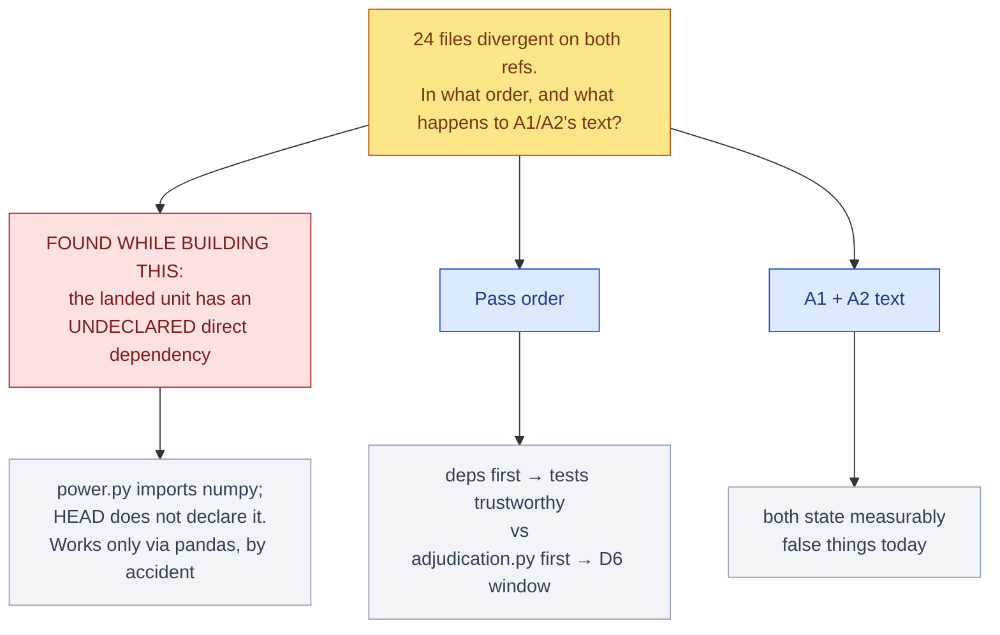

# Stage 2 reconciliation — two decisions, and a live defect found while building this page

<!-- HACP L1 · Kind = Decision · Section = decision · Indexed by "ChipSim (bioFM) — Index".
     SOURCE OF TRUTH: the Notion row; this file mirrors it. See notion-map.json.
     Built with .claude/skills/hacp-decision-surface. No identifier, biological number or
     chemical key appears on this page by design. -->

**Kind:** Decision · **Layer:** L1 · **Pinned:** bioFM `main` `a7a0678`, lung `lung-on-chipsim` @ `97fe634` · **Stale by construction — re-derive at decision time**

## The junction

A1's transfer landed 41 files. It then stopped, because **24 files exist on both refs with different
content** and A1's manifest assumes the gap is presence-vs-absence. Two things need deciding, and
building this page surfaced a third that is not a decision but a defect.

*The red branch is not an option — it is a defect in work already committed, and it changes the ordering question.*

## Decisive evidence — facts that change which option wins

Each row measured directly at the ref named. Nothing here is graph-derived; the repository knowledge
graph is dated **2026-09-18** at commit `81bee6d5`, **over a month stale** against `a7a0678`, so it was
used only to locate candidates and **no figure on this page comes from it.**

| # | fact | measured by | weight |
|---|---|---|---|
| 1 | `chipsim/audit/power.py` is **in** the landed 41-file unit, and imports **`numpy` directly** (line 32) | `git show --name-only 97fe634`; `git show lung-on-chipsim:…/power.py` | **decisive** |
| 2 | HEAD's `pyproject.toml` does **not declare numpy**; Stage 1's does | `grep -cE '^\s*"numpy"'` on both refs → 0 / 1 | **decisive** |
| 3 | Stage 1's own comment names this hazard: *"imported directly by `chipsim/audit/power.py`; previously arrived only transitively via pandas, which is a dependency you cannot see (A8)"* | the file itself | **decisive** |
| 4 | Dependency divergence is **bidirectional** — Stage 2 uniquely has `ty`, `pytest-asyncio`, `asyncio_mode = "auto"` and the `sandbox = ["fhaviary"]` extra | `diff` of `pyproject.toml` across refs | **decisive** |
| 5 | `h5py` is Stage-1-only and its consumer is the **record-content guard, which A1 excludes** | the file's own comment + A1's exclusion list | constraining |
| 6 | `adjudication.py`: Stage 1 is a **strict superset** — 9 symbols only there, **0** only on HEAD | symbol diff across refs | constraining |
| 7 | D6's approved protection (`export_tracked_adjudication`) is **absent on HEAD** — 0 occurrences vs 6 | `grep -c` on both refs | constraining |
| 8 | 24 divergent files, **disjoint** from the 41-file unit (41 A / 0 M) | blob-hash join over `git ls-tree` on both refs | contextual |
| 9 | A1 names **five** of the 24 for transfer: `roster.py`, both S13/S14 templates, `data/raw/sources.yaml`, ADR-0003 | A1's text vs the divergent set | constraining |

### What facts 1–4 mean together

**`pyproject.toml` cannot be taken from either side.** Stage 1 has a dependency Stage 2 needs
(`numpy`, now that the audit code has moved); Stage 2 has four things Stage 1 never had (`ty`,
`pytest-asyncio`, the asyncio mode, the sandbox extra). Taking Stage 1's wholesale would **destroy
Stage 2's async test configuration and its sandbox extra.** It is a genuine merge.

**And the ruling that produced the unit was right but incomplete.** "Items travel with their tests"
paired code with its verification. It did not pair code with its **dependency declarations** — so the
unit moved a direct `numpy` importer onto a branch that resolves numpy only transitively, which is the
precise failure Stage 1 had already diagnosed and fixed. **Same half-transfer shape, one layer below
tests.**

`h5py` is the control that shows the exclusions were right: it is Stage-1-only, and its only consumer is
excluded, so it should **not** be added.

## Decision 1 — pass order

| option | does | rules out | then what |
|---|---|---|---|
| **A — patch the numpy declaration now, then `adjudication.py`, then the rest** ★ | Closes a defect in *already-landed* work immediately; then unblocks D6; then the remaining 22 as a merge pass | Rules out treating the full dependency merge as a prerequisite — `uv.lock` stays divergent for now, so suite results remain provisional | One-line amendment to the landed unit, then the `adjudication.py` + `test_adjudication.py` pair |
| **B — full dependency merge first (`pyproject.toml` + `uv.lock`), then code, then tests** | Makes every later suite result trustworthy evidence before anything is judged on it | Rules out restoring D6's protection first; the window stays shut longer | A real merge of two divergent dependency sets before any module is touched |
| **C — `adjudication.py` first, dependencies later** | Fastest restoration of the protection you approved in D6 | Rules out trusting any suite result until the dependency sets agree — and leaves the numpy defect live in landed work | D6 unblocked; the numpy gap persists meanwhile |

★ **Recommended: A.** Fact 1–3 make the numpy gap a defect in work that has *already landed*, and it is
a one-line fix; leaving it live while doing larger work is how a known defect becomes a surprise. D6 is
second because its window closes only on the first typed verdict, and nothing can be typed until
`adjudication.py` resolves anyway.

## Decision 2 — A1 and A2's text

Both now state things measurably false, and a third defect joins them:

- **A2** — "the archived tip holds the **only copy** of `transport/{ode,fit,prior,theta}.py`": true for
  `ode.py` and `fit.py`, **false** for `prior.py` and `theta.py`, which exist on both refs as different
  blobs.
- **A1** — assumes the gap is presence-vs-absence. **Wrong in five named places** (fact 9).
- **A1's scope ruling** — "items travel with their tests" is **incomplete**: items also travel with
  their dependency declarations (facts 1–3).

| option | does | rules out | then what |
|---|---|---|---|
| **A — amend all three in place, dated, originals struck but visible** ★ | Corrects the record where a later reader will look, on the row-29/30 in-place-correction precedent | Rules out a clean re-statement; the log keeps struck wording | Three dated amendments in the approval log |
| **B — retire A1 + A2, re-rule Stage 2's transfer from scratch** | Cleanest end state, one coherent ruling covering transfer *and* reconciliation | Discards two principal rulings and the reasoning recorded with them; re-opens settled scope | A fresh grill and a new ruling |
| **C — leave the text, record the defects only here** | Least disruption to the log | Leaves rulings stating known-false things, which a later reader would act on | Nothing; the defects live only on this page |

★ **Recommended: A.** The defects are factual, local, and already measured. The precedent for correcting
a ruling's text in place with disclosure exists in this very log (rows 29/30), and it preserves the
reasoning that made the original defensible.

## Already decided, held pending this page

**`adjudication.py` + `test_adjudication.py` — take Stage 1's version, as one decision.** Chosen
2026-10-20; recorded once the pass order is set, since it is the pass's first item under options A and C.
Basis: fact 6 (strict superset, nothing unique on HEAD), its shared bodies are hardenings, and the one
renamed parameter breaks no real caller — every HEAD caller is positional or docstring-only.

## Gaps, stated rather than filled

- **`uv.lock`** — divergent, and not inspected line-by-line. Under option A it stays divergent for now,
  which is why suite results remain **provisional** until it is merged. Not a reason to defer A.
- **The remaining 22 divergent files** — known divergent by blob hash; the *nature* of each difference is
  measured only for `adjudication.py` and `pyproject.toml`. The other 20 are named, not characterised.
- **The knowledge graph is a month stale** (2026-09-18, `81bee6d5`). Used to locate candidates only.

---

**Provenance.** Built with `.claude/skills/hacp-decision-surface`. Divergent-set scan, blob comparisons,
symbol diffs and dependency diffs measured by the CTO at `a7a0678` / `97fe634`. The 24-file scope
correction and the `adjudication.py` diff shape were the lung-on-chipsim agent's findings, verified
independently here. Facts 1–3 were found while building this page. Re-derive every figure at decision
time per the Stage 1 methods note's own rule.
