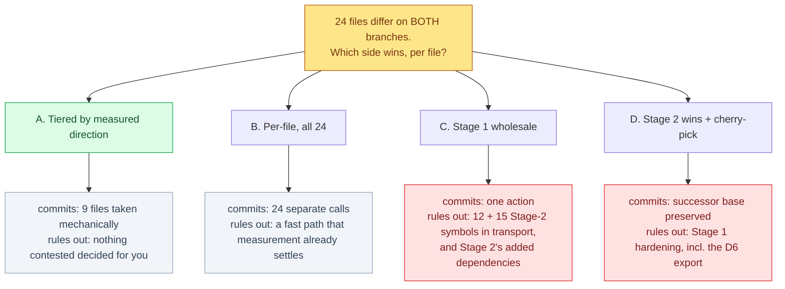

# Stage 1 / Stage 2 divergence — which side wins, per file

**Kind:** Decision · **Layer:** L1 — Review · **Project:** bioFM · **Section:** decision
**Pinned to:** `f79f066` (branch `lung-on-chipsim`) — **stale by construction**; every figure is
re-measured when the decision is taken.
**Blocked on the principal because:** the CTO ruled *"do not merge either direction on your own
authority; both sides are live work."* The A1/A2 text amendments are ruling edits.

## The junction

24 files exist on **both** the archived Stage 1 tip and the Stage 2 successor branch **with different
content**. A1's transfer manifest assumes the gap is presence-vs-absence. It is not. These cannot be
transferred; each is a reconciliation.

*Takeaway: only one of the 24 is a clean Stage-1 win. Wholesale in either direction destroys real work.*

## Decisive evidence — measured, not inferred

Blob-compared `git ls-tree -r` on both refs, joined on path. Line counts from `diff`; symbol counts
from top-level `def`/`class`/CONSTANT extraction. **Instrument validated** against a known value
(`adjudication.py` = 389 Stage-1-only / 26 Stage-2-only) before the table was generated.

| tier | files | measurement | disposition |
|---|---|---|---|
| **1 — Stage 1 superset** | 1 — `docs/adr/0003-…md` | 22 added, **0** Stage-2-only lines | mechanical: take Stage 1 |
| **2 — Stage 1 hardening** | 8 — `adjudication.py`, `ids.py`, `pgp_label.py`, `roster.py`, `test_adjudication.py`, `test_parse.py`, `test_provenance.py`, `test_workflow_export.py` | Stage-1-only lines ≫ Stage-2-only, and **0 Stage-2-only symbols** | low-risk: take Stage 1 |
| **3 — contested, same symbols** | 2 — `test_fixtures.py` (14 vs **20**), `test_journal.py` (5 vs 5) | Stage 2 has as many or more unique lines | per-file call |
| **4 — both sides unique** | 7 — `drugbank_snapshot.py` (1), `pipeline.py` (**7**), `transport/prior.py` (**12**), `transport/theta.py` (**15**), `test_monotonicity.py` (1), `test_scaffold.py` (1), `test_snapshot_fetch.py` (1) | Stage 2 has its own symbols, count in brackets | per-file call — real reconciliation |
| **5 — config / build** | 6 — both `configs/templates/*.scaffold.yaml`, `data/raw/sources.yaml`, `pyproject.toml` (7 vs **15**), `README.md` (74 vs **89**), `uv.lock` (33 vs **27**) | Stage 2 larger in three of six | per-file call |

**Three facts that change which option wins:**

1. **`transport/prior.py` and `transport/theta.py` carry 12 and 15 Stage-2-only symbols.** This is
   substantial Stage 2 authorship, not drift. It also sharpens A2: its "only copy" clause is not merely
   half false, Stage 2 has *more* symbols in these two than Stage 1 does.
2. **`pyproject.toml` and `uv.lock` are divergent with Stage 2 larger** — the two sides may not resolve
   the same dependency set, so **no suite result from either side is comparable evidence until these are
   settled.** This is an ordering constraint, not a preference.
3. **`adjudication.py` gates D6.** `export_tracked_adjudication` appears 6 times on Stage 1 and **0** on
   the branch where the 26 verdicts will be typed, so the protection the principal approved is not
   present. Nothing can be typed until this file resolves.

## Constraints

- Notion writes are CTO-only; this surface is prepared here and handed over.
- `transport/` additionally holds 2 Stage-1-only files (`ode.py`, `fit.py`) and 1 Stage-2-only
  (`sourcing.py`) — outside the 24, already the principal's per-file call.
- Row 61 stands: do not open by repairing the register.

## Gaps, stated as gaps

- **The knowledge graph is unusable for this decision.** It was analysed 2026-09-18 at `81bee6d`,
  predating the Stage 2 branch and the divergence entirely. No row above is graph-derived.
- **A measurement of mine failed and was caught before use.** A first classification run double-prefixed
  its paths, so every `git show` returned empty and all 24 files compared as identical — a confident
  all-clear from a broken instrument. It was caught only because the output contradicted a value
  measured earlier by hand. The table above comes from the rebuilt, validated run.
- **An earlier "disjoint — confirmed" claim rested on that same broken list.** The conclusion is still
  true, but on different evidence: the transfer commit shows 41 additions and 0 modifications, which is
  what actually proves nothing was overwritten. Right answer, invalid reasoning, corrected here.

## The ask

Choose the reconciliation strategy. Tier 1 and 2 are mechanical under option A; tiers 3-5 (15 files)
remain per-file calls in every option.
