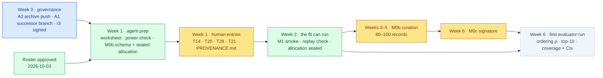

# ChipSim — status, timeline and decision history

<!-- HACP L1 · Kind = Presentation · Section = vision · Indexed by "ChipSim (bioFM) — Index".
     SOURCE OF TRUTH: the Notion row. This file mirrors it; see notion-map.json.
     Created 2026-10-14 to hold the state, chronology and decision history that had been pasted
     onto the project index. Per the HACP governance contract, an index carries entry points and
     the material ask; measured state and chronology live behind an inline entry. -->

**Kind:** Presentation · **Layer:** L1 · **Holds:** where the project stands, the dated timeline, and every decision already taken · **Reaches:** [the index](index.md), [§decision](decision.md), [§experiment](experiment.md)

> ## Stage 1 is CLOSED and the branch is ARCHIVED — 2026-10-01
>
> The final gate **failed on the same mechanism**. Under approval-log row 61 (principal, verbatim *"Stop; the mechanism is the result"*) and CTO #541, Stage 1 **closes at the scope reached**: no QGR receipt is signed, nothing was pushed, the branch does not land. Principal's disposition the same day: **archive, and preserve the record on main.**
>
> **The result is the mechanism, stated plainly:** *a fix is verified against the thing that was changed, not against the property the claim names.* Nine dated instances, six of them introduced by the repair of a previous instance. **Record:** `workstreams/lung-on-chipsim/qgr/stage1-closure.md` + the deferred-findings register, preserved on `main` (78 of 83 files; five withheld because they carry structure identifiers). **Owed:** a clean re-measurement of the suite before any future timing-ceiling call.

## Where the project stands

**The rig is built. The experiment has not run — and nothing in the way of it is a decision any
more.** No fit, no coverage, no frozen evaluator, 0 of 80–100 curated chip records. The roster is
approved as final (26 entries, 2026-10-03); the twelve governance rulings of 2026-10-04 cleared
every open question; and as of 2026-10-14 the sandbox is wired and six of six θ fields are backed.
What remains is human-written scientific input and one signature.

**Measured from** `main` @ `38bf64e` (2026-10-03) and the archived branch on `origin` @ `c04e701`
(2026-09-20). The archived tip (435 commits further, holding the M1 transport code) is on no
remote; it is cited from the CTO's records, never as verified.

## Status at a glance

| | Value | Kind |
|---|---|---|
| Agent-implementable tasks, M0a slice 1 | 29 of 29 | recorded (build plan) |
| Human-owned inputs | T2, T8, T18 delivered (T18 approved 2026-10-03); T1 half; T14, T20, T21, T28, M0b, M0c absent | measured from `configs/` and `data/raw/` on `c04e701` |
| Test suite, last clean run on the archived branch | 1,013 passed / 3 failed / 9 skipped / 16 network deselected on `c04e701` | **measured 2026-09-28** |
| Test suite, this branch | 473 passed / 0 failed / 5 skipped | **measured 2026-10-14** |
| Plan revisions, hash-locked | 61 numbered, 65 rows; 47 standing-delegation | re-derived at `af17cd2` by the closure's own instrument |
| Gates on the content guard and the paper | 9 on E-22/E-23 (4 FAIL accepted), Stage 1 final gate FAIL | recorded, approval log rows 43–61 |
| Simulation, evaluation or fit runs | 0 | recorded; nothing to measure |
| Biological numbers written by an agent | 0 | the standing constraint, enforced by validators |
| Code locations the successor must reconcile | 3 — `main`, `origin/lung-on-chipsim` @ `c04e701`, the archived tip on one disk | measured 2026-10-03 |
| M1 input contracts built (S13, S14, T21, T24, T28) | 2 scaffolds, 3 validators, 6 CLI commands | **measured 2026-10-14** |
| θ fields backed by a source | **6 of 6** — 3 cited verbatim from the primary device paper, 3 assumed with stated widths | **measured 2026-10-14** |
| Sandbox, wired as an aviary environment | `LungMembraneEnv` runs; its first behaviour is a structured refusal naming every blocking artifact | **measured 2026-10-14** |
| Milestones with no plan done-conditions | 2 — M0b and M0c, deferred by the build plan to "its own plan"; a [plan draft](../../../workstreams/lung-on-chipsim/plan/m0b-m0c-plan-draft-2026-10-04.md) awaits signature | measured 2026-10-04 |

## Timeline (planning targets set 2026-10-03)

*Amber is a claim only a human may write. Green is agent work: schema, validators, tooling, simulations, never a biological value. Blue is the CTO's land.*

| Week | Dates | Principal | CTO / agent | Exit condition |
|---|---|---|---|---|
| 0 | 10-03 → 10-07 | push the archived tip to `archive/` (A2); sign plan r3 (C1–C3 ruled 10-04) | cut the successor branch by content (A1); clean suite re-measurement; land the floor | r3 verified; the successor suite green and timed |
| 1 | 10-08 → 10-14 | T14 adjudication (60–90 min); T20 / T28 / T21 entries (~1 h); `PROVENANCE.md` (5 min) | emit the T13 worksheet; run the audit power check; write the M0b schema, validator and sealed-allocation tool | every M1 input present and validator-green |
| 2 | 10-15 → 10-21 | start M0b curation; decide whether the pair stratum runs in parallel | T15 loads labels; M1 smoke run with the replay check; seal the allocation **before** the first record is read | the fit executes on sourced θ; the allocation digest is written |
| 3–5 | 10-22 → 11-11 | M0b records to 80–100 | build the M0c evaluator: frozen splits, three controls, locked test set | the validator accepts every record; the signature slot is empty |
| 6 | 11-12 → 11-18 | sign the evaluator freeze (B8) | first evaluator run on the sealed allocation; result-review row under §eval | ordering ρ, top-10 recovery, coverage with per-group CIs |
| 7 | 11-19 → 11-25 | ratify the closure methods note (A4a, drafted by 10-17); choose the Stage 2 path | — | publication path recorded |

Every date is a target, not a measurement. The plan's own human-time estimates are used where they
exist (T14, T20, T21, T28, T1); M0b has none and its 3–4 weeks is a planning assumption replaced by
the measured rate in week 2. **Week 1's human entries slipped**: as of 2026-10-14 they are drafted
from cited sources and awaiting ratification, not delivered.

## Decisions taken

| Decision | Chosen | Alternatives considered | Why this one | Date |
|---|---|---|---|---|
| Where DrugBank comes from | A public 2015 snapshot pinned by commit, DVC-tracked, never vendored | The licensed current release behind an application gate | Zero administrative lead time; identity and drug→transporter edges are all M0 needs | 2026-08-30 |
| Who writes a biological number | Nobody but the human; the agent writes the schema and the validator that rejects an unsourced entry | Agents draft values with citations for human review | A fabricated citation passes every schema check ever written | 2026-08-30 |
| How the roster is authored | Hand-curated by the principal from a guarded 39-candidate list, 26 with a resolvable DOI | Filter the snapshot mechanically | Lung relevance is a claim, not a filter result | 2026-09-20 |
| **Roster approved as final** | 26 entries stand; no further curation before Stage 2 | reopen the roster after adjudication | the worksheet and the sealed allocation both need a fixed compound set | **2026-10-03** |
| The T8 deletion criterion | Delete a panel entry only on positive evidence of absence | Delete anything not annotated as airway-expressed | A curated sample is not an atlas | 2026-09-01 |
| PoC calibration size | ~20 conformal points per P-gp group in a three-way sealed allocation of 80–100 records | 200–240 records; thin the locked set; marginal coverage | Conformal coverage is valid at any n; only precision degrades | 2026-09-02 |
| The audit's power floor and roster shape | Simulated power ≥ 0.80 at Δρ = 0.5; ~30 diverse compounds + a curated pair stratum of ~50 | A 0.70 floor; one integrated ~60 set; pairs discovered from the roster | Composition buys more power than count | 2026-09-08 / 09-11 |
| What the run journal records | Config copies, resolved versions, digests; **not** git state | Shell out to `git` at runtime | A planted repository ran arbitrary commands three times in the gate | 2026-09-02 |
| E-23 time box and descope | one revision after a gate-8 fail; requirement 5 descoped to reporting | patch the survivors; a ninth revision | machinery growing faster than the evidence that any of it works | 2026-09-28 / 09-29 |
| Stage 1 repair | **stopped** — *"Stop; the mechanism is the result"* | another repair round | across four gate rounds one mechanism recurred, four times introduced by repair | 2026-09-30 |
| Stage 1 disposition | **archive; preserve the record on main** | reopen; land; delete | the record must not depend on one machine's disk | 2026-10-01 |
| **Where Stage 2 builds** | a successor branch from `main`, science-bearing files by content, guard machinery left closed | land the archived branch; restart from `main` | the archived branch carries 36 registered findings and five withheld files | **2026-10-04** |
| **The withheld files** | leave the five on the archived branch; the gap stays recorded | redact, then publish to `main` | redacting hash-covered evidence is the principal's alone | **2026-10-04** |
| **The closure as a publication** | a standalone short methods note | fold it into the Stage 2 paper; do not publish | it is the only publishable thing the branch produced | **2026-10-04** |
| **M0b curation shape** | one curator, the principal; the rate re-measured after ten records | a named second curator; defer M0b | a measured rate is worth more than a second pair of hands against one validator | **2026-10-04** |
| **AM-6 residual (C2)** | struck as superseded by ADR-0002 | pre-register the contingency; leave it open | the arithmetic was closed in 2026-09 | **2026-10-04** |
| **SLC15A1 (C1)** | kept under the T8 ruling; re-checked at the M1 re-ratification | revisit now with a citation; drop it | contested in the literature is not positive evidence of absence | **2026-10-04** |
| **Publication target** | a journal method **plus** a sandbox others can request access to | a registered report alone | validation, not modelling capacity, is the bottleneck, so the checkable artifact is half the contribution | **2026-10-14** |
| **The dimensionality lever** | keep free parameters near the observation count; embeddings are one benchmarked arm | pretrained embeddings as the architecture | a broad benchmark finds no consistent gain over fingerprints at this n | **2026-10-14** |

## How these figures were made

Counts marked *measured* were read from the files or produced by running the suite; counts marked
*recorded* are copied from a receipt, a signed plan row, or the closure record with its date. The
product cut of 2026-09-19 and the paper walkthrough of 2026-10-02 remain indexed as Presentations.

Back to the [index](index.md).
