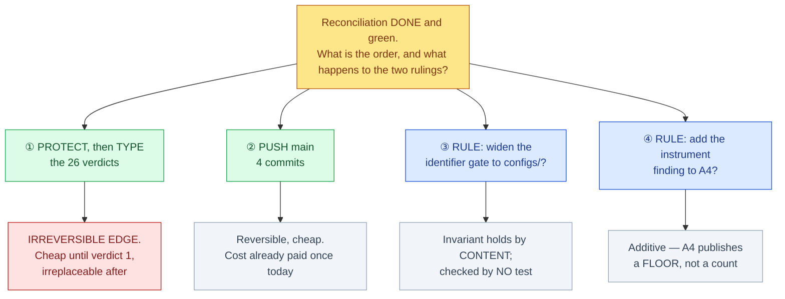

# Unblock direction — reconciliation is DONE and green; four things stand between here and a running experiment

<!-- HACP L1 · Kind = Decision · Section = decision · Indexed by "ChipSim (bioFM) — Index".
     SOURCE OF TRUTH: the Notion row; this file mirrors it. See notion-map.json.
     Built with .claude/skills/hacp-decision-surface. No identifier, biological number or
     chemical key appears on this page by design — form is described, never a value. -->

**Kind:** Decision · **Layer:** L1 · **Pinned:** bioFM `main` `868cadc`, lung `lung-on-chipsim` `fdd585d` · **Stale by construction — re-derive at decision time**

## The junction

**Stage 2 reconciliation is complete.** Measured under the CI selector (`-m "not network and not
integration"`), lock regenerated: **814 passed / 5 skipped / 0 failed / 0 collection errors**; `ruff`
clean; `ty` **25** diagnostics against a **28** baseline. Two days ago it was 25 failed + 4 collection
errors. **All five reconciliation decisions are ruled** (approvals rows 28–32).

So nothing technical is blocking. What remains is **four items, all yours**, of three different kinds —
and only one of them has an **irreversible edge**, which is what should set the order.

*Only ① cannot be undone. Everything else on this page can be done in any order, later, at no cost.*

## Decisive evidence — each row measured directly, none graph-derived

The repository knowledge graph is dated **2026-09-18** at commit `81bee6d5`, **over a month stale**
against `868cadc`. It was not used. **No figure on this page comes from it.**

| # | fact | measured by | weight |
|---|---|---|---|
| 1 | The adjudication worksheet is a **regenerable blank scaffold today** and becomes **irreplaceable at the first typed verdict** — it is untracked, on one disk, and absent from both the branch and the bundle | the standing D6 measurement, re-affirmed | **decisive** |
| 2 | **D6's protection is finally usable**: the export function imports, and both worksheet CLI commands exist and are registered | import check + CLI registry at `9deade3` | **decisive** |
| 3 | The agent reports D6 **proven end-to-end** on a copy — never-clobber guard firing, both probe verdicts surviving | agent, not independently re-run by the CTO | constraining |
| 4 | **4 commits** on `main` are unpushed; they are the ledger fixes for rows 31, 33 and 34 | `git rev-list --count origin/main..main` | **decisive** |
| 5 | The cost of an unpushed record was **paid once today**: the approvals log did not exist on the remote at all, so rows 1–32 were published nowhere while the defective text they correct **was** public | measured before and after the push | **decisive** |
| 6 | The identifier invariant's condition **HOLDS by content** — every structure in both config files carries a public-source pointer, one per structure | structural parse (`yaml.safe_load`), not regex | constraining |
| 7 | The enforcing test globs **only** `tests/fixtures/snapshot/*.tsv`, so ~**154** identifier lines under `configs/` are checked by **no test** | the test's own glob, line 36 | constraining |
| 8 | A4 publishes its enumeration as **"a floor, not a count — at least ten"**, so an added instance does not invalidate its claim | A4 §3.3, ratified | constraining |

### What rows 1–2 mean together

**The window is open and it closes on your keystroke, not on a date.** For the whole of this
workstream the protection question was moot because nothing could be typed — D6's export did not even
import. That changed at `9deade3`. So for the first time the worksheet can be generated, protected and
exported *before* it holds anything irreplaceable, and that state ends permanently at verdict one.

### Why row 7 is a gap and not an exposure

The invariant permits bare structure identifiers in tracked files **on condition each cites a public
source**, and row 6 shows the condition holds. The defect is that a **gate is narrower than the
invariant it enforces** — satisfied by content, unverified by machinery. Nothing is currently wrong;
the next edit is unguarded.

## Direction — the recommended order, and why

1. **Protect, then type.** ① first and alone, because it is the only irreversible step on the page.
2. **Push.** ② next; it is four commits and today already demonstrated the cost of not doing it.
3. **The two rulings** can wait for either, and neither blocks the experiment.

## The two rulings

### ③ Widen the identifier gate to `configs/`?

| option | does | rules out | then what |
|---|---|---|---|
| **A — widen it ★** | Puts ~154 identifier lines under the same machinery as the snapshot fixtures, so the invariant is enforced where it currently holds by luck of curation | Rules out leaving `configs/` unguarded; costs one test change and may surface entries needing a citation field added | The agent widens the glob and adds the per-file citation assertion |
| **B — leave it** | No work, and nothing is wrong today | Leaves an invariant that a future edit can break silently, in files that are already public | The gap stays recorded on this page and in approvals row 33 |
| **C — widen, and require a declared scope list** | Enforces it AND makes future additions explicit rather than glob-dependent | More machinery than the defect warrants right now | A scope registry — which row 61's lesson argues against |

★ **A.** The condition already holds, so widening costs little and converts curation discipline into a
check. **C is deliberately not recommended:** a scope registry is the shape E-23 closed on.

### ④ Add the two-author instrument finding to A4?

| option | does | rules out | then what |
|---|---|---|---|
| **A — add it ★** | Records the cleanest instance yet: **the same wrong instrument produced opposite wrong answers** — a false violation and a false absence, on one file, in one hour, by two authors, caught by neither tool | Re-opens a ratified note's text, which needs a dated amendment and a re-pin | One instance added under §3.2/§3.5, pin updated, no count re-typed |
| **B — leave it in the ledger** | A4 stays closed; the finding survives at approvals row 34 | The paper's instrument section omits its sharpest example | Nothing |

★ **A**, on one ground: **A4 was built for this.** §3.3 publishes a **floor, not a count**, precisely so
a new instance is additive rather than a correction. *You are author of record; this is your text.*

## Gaps, stated rather than filled

- **Row 3 is the agent's, not re-run by the CTO.** D6's end-to-end proof is reported, not independently verified here.
- **Both copies of the withheld-file tip are LOCAL** — the bundle and the archive branch, which is on no remote. Same durability family as row 5, not yet paid for.
- **The lung branch is 596 ahead of its own remote.** Separate from ②, and not required for any item above.
- **One pre-existing public exposure is carried, not fixed** — a committed audit record quotes an identifier; it predates this work and the standing ruling is that committed audit records stay as written. Reconsidering it is a fresh decision.

---

**Provenance.** Built with `.claude/skills/hacp-decision-surface`. Every figure measured by the CTO at
`868cadc` / `fdd585d`; the knowledge graph was checked for freshness, found a month stale, and not used.
Rows 6–7 correct a CTO false-violation and an agent false-absence that shared one cause — see approvals
row 34. Re-derive every figure at decision time, per the Stage 1 methods note's own rule.
