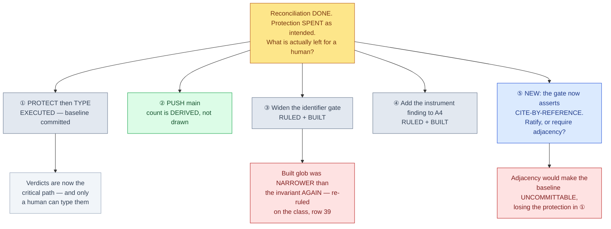

# Unblock direction — three of the four junctions are now CLOSED; one new one is open because I ruled it myself

<!-- HACP L1 · Kind = Decision · Section = decision · Indexed by "ChipSim (bioFM) — Index".
     SOURCE OF TRUTH: the Notion row; this file mirrors it. See notion-map.json.
     Built with .claude/skills/hacp-decision-surface. No identifier, biological number or
     chemical key appears on this page by design — form is described, never a value. -->

**Kind:** Decision · **Layer:** L1 · **Pinned:** bioFM `main` `92fdc2e`, lung `lung-on-chipsim` `dc03120` · **Stale by construction — re-derive at decision time**

> **AMENDED IN PLACE 2026-10-23, and the reason is this page's own subject.** The first version of this
> page presented ③ as an open ruling **after it had been ruled and built**, and carried a gate figure
> that was already two measurements out of date. Caught by the lung agent, not by me — on the page a
> human would decide from, which is the third time in this thread a true claim has been published at
> the wrong extent. Every figure below was re-measured at the pins above before this edit.

## The junction

**Reconciliation is complete and the irreversible edge is closed on the safe side.** The blank tracked
adjudication baseline is committed, so the verdicts can be typed against never-clobber from verdict
one rather than after the first irreplaceable keystroke. Three of the four items this page opened with
are decided. **One genuinely new decision is open, and it is open because I took it under delegated
authority and it has a stated reversal cost.**

*The grey nodes need nothing from you. ⑤ is the only live junction, and it exists because a delegated
call should be visible rather than quiet.*

## Decisive evidence — each row re-measured at the pins, none graph-derived

The repository knowledge graph is dated **2026-09-18** at commit `81bee6d5`, now **five weeks stale**
against `92fdc2e`. It was not used. **No figure on this page comes from it.**

| # | fact | measured by | weight |
|---|---|---|---|
| 1 | The tracked baseline is **committed blank** — row count intact, the four human-owned verdict columns empty in every row, and the **name column absent** | `csv.DictReader` over the blob at the lung ref | **decisive** |
| 2 | It is committed on the **lung branch, not on main** — and the file that supplies its citations exists on the lung branch and **not** on main | `git ls-tree` on both refs | **decisive** |
| 3 | Every structure in the baseline resolves to a citation **elsewhere under the same `configs/` tree**; none is unresolvable, none resolvable-but-uncited | structural parse of both files at the lung ref | **decisive** |
| 4 | **TWO suite numbers, and this page previously published the wrong one as "the gate".** The *configured* quality command is `cd projects/lung-on-chipsim && uv run pytest -q` — **unselected** — so the gate figure is **850 passed / 4 skipped / 0 failed**. The *selected* figure, `-m "not network and not integration"`, is **819 / 4 skipped / 31 deselected**. Both are real; they answer different questions, and the 31 deselected are **in** the configured gate. There is also **no GitHub CI on `main`**, so "the CI selector" was a misnomer twice over | `config get quality.test_command_lung-on-chipsim`, then each command | **decisive** |
| 4b | `ruff` clean. **`ty` is scope-dependent and this page previously published the package figure as the project's**: `ty check chipsim` → **25**, `ty check tests` → **31**, `ty check .` → **56**. `ty` is **not** a gate here (`typecheck_command_lung-on-chipsim` is deliberately empty), so nothing downstream relied on the figure — but a published number that names the wrong subject is the defect itself | `uv run ty check` at each of the three scopes | constraining |
| 5 | `main` carries unpushed commits — **read the count off the command, never off this page**: it was 4 when this page was first written, 2 at the amendment, and 4 again within the half-hour because the amendment itself committed. **No bare numeral survives here** | `git rev-list --count origin/main..main` | **decisive** |
| 6 | The widened gate globs one **format**, and the first new file under the widened **directory** was a different format — so its structures are unread by the gate **and** by the gate's own anti-vacuity count | the test's own glob, both call sites | **decisive** |
| 7 | An unparseable file is skipped by that gate **as compliant**, and its anti-vacuity floor is a **hard-coded constant** | the test's exception handler and its assertion | **decisive** |
| 8 | The lung branch is far ahead of its own remote — **688 when measured at the pin**, and like row 5 it moves on its own; re-derive rather than quote | `git rev-list --count origin/lung-on-chipsim..lung-on-chipsim` | contextual |

### What rows 1–3 mean together

**The protection is real and it is real on one branch.** The window that was open "until verdict one"
has been **spent as intended** rather than described: a blank re-export over a filled tracked file is
now refused, not merged. The measured failure this guards against left none of the verdicts in place
and reported success. But the publication basis is a statement about the **lung branch** — on `main`
the citing file is not there, so the same claim is false of `main`. That distinction was missing from
my first statement of it, and row 2 exists to stop it going missing again.

### What rows 6–7 mean together — and why they produced ⑤

The widening in ③ was built, and it was built **narrower than the invariant it enforces** — the same
defect it was commissioned to fix, along a second axis: the directory was widened and the format was
hard-coded. The agent found this within minutes of the baseline landing and **asked for a ruling
instead of widening again**, which was the right call. Two further defects were found here rather than
in its report: an unparseable file passes, and the anti-vacuity check **globs the same single format**,
so the check that exists to prove the gate is not vacuous is blind to exactly what the gate is blind
to. Ruled on the class at approvals **row 39** — discovery goes format-agnostic over tracked files and
**fails closed**, anti-vacuity becomes per-file derived rather than a constant, and satisfaction moves
to **cite-by-reference**. That last part is ⑤, because it changes what the gate asserts.

## ⑤ The gate now asserts CITE-BY-REFERENCE. Ratify it, or require adjacency?

A blank adjudication baseline is **legitimately uncited in its own file** — its citation column exists
and fills as you work. So the gate had to choose what "cites a public source" ranges over.

| option | does | rules out | then what |
|---|---|---|---|
| **A — ratify cite-by-reference ★** | A structure is satisfied if its own mapping cites a source, **or** the same structure is cited by another tracked file in the same project's `configs/`. Mechanises the predicate the baseline was already authorised on | Rules out reading the invariant as *adjacent*; the guarantee now depends on a second file in the same tree, which the gate re-resolves every run | Nothing — it is ruled at row 39 and the agent is building it. Ratifying makes it principal-routed instead of delegated |
| **B — require adjacency (each file cites its own structures)** | The strictest reading, and the one the first widening implemented | **Rules out committing the blank baseline at all** — it would forbid the very act that protects the work, and ① would have to be undone | The protection in ① is lost, or a named exemption is introduced after the scope registry was declined |
| **C — exempt the adjudication destination by name** | Simple and true today | Stops asserting anything about that file forever, and is one step from the scope registry declined at row 36 | A named exemption in the gate |

★ **A, on one ground that is not preference:** it is the predicate the baseline was **already committed
on**. The condition the invariant states is that provenance is **checkable**, not that it is
**adjacent** — and a gate asserting adjacency would assert something stricter than the rule actually
ruled, while destroying the protection in ①. **B's cost is stated rather than hinted**, because it is
the only option on this page that undoes work already done. **C was declined with a reason, not a
preference.**

## Already closed — no options table, because there is nothing left to choose

- **① PROTECT then TYPE — EXECUTED.** Baseline committed; approvals row 38. The verdicts are now the
  critical path and only a human can type them. They go in the **untracked** working copy, then
  re-export; **never hand-edit the tracked file** — a refused re-export is the protection working.
- **③ Widen the identifier gate — RULED (row 36) and BUILT, then RE-RULED on the class (row 39)** after
  the built version reproduced the defect. The options table that stood here is gone; what replaced it
  is ⑤.
- **④ Add the instrument finding to A4 — RULED (row 37) and BUILT.** The amendment is committed: the
  instance admitted, a section added, **one existing claim narrowed because it would not have caught
  this instance**, the re-derivation recorded as reproducing, and the pin updated. **It awaits your
  ratification as author of record — that is authorship, not a ruling.**
- **② PUSH — still open.** Reversible and cheap, and the cost of not doing it was paid once already
  in this workstream. **The count is deliberately not stated here** — see row 5. Publishing it is what
  made this page wrong twice in one day, which is the HACP rule *no bare numerals in a published
  figure* earned the hard way, by the author of the rule.

## Gaps, stated rather than filled

- **Both copies of the withheld-file tip are LOCAL** — the bundle and the archive branch, which is on
  no remote. The same durability family as the unpushed-ledger cost, and still not paid for.
- **The lung branch is far ahead of its own remote** (row 8, 688 at the pin). Separate from ②, required by nothing above.
- **`configs/*.csv` is outside the identifier gate** until row 39 is built. Zero new exposure measured,
  but the next file of an unlisted format is unguarded — which is the whole point of ruling on the class.
- **One pre-existing public exposure is carried, not fixed** — a committed audit record quotes a
  structure identifier; it predates this work and the standing ruling is that committed audit records
  stay as written. Reconsidering it is a fresh decision, not a carried task.
- **The end-to-end D6 proof on a copy is the agent's**, re-verified here only on the committed result,
  not re-run.

---

**Provenance.** Built with `.claude/skills/hacp-decision-surface`. Every figure re-measured by the CTO
at `92fdc2e` / `dc03120` before this amendment; the knowledge graph was checked for freshness, found
five weeks stale, and not used. The staleness that prompted the amendment was the lung agent's finding;
rows 6–7 are the CTO's, two of the three defects in row 6–7 having been absent from the agent's own
report. Re-derive every figure at decision time, per the Stage 1 methods note's own rule.
