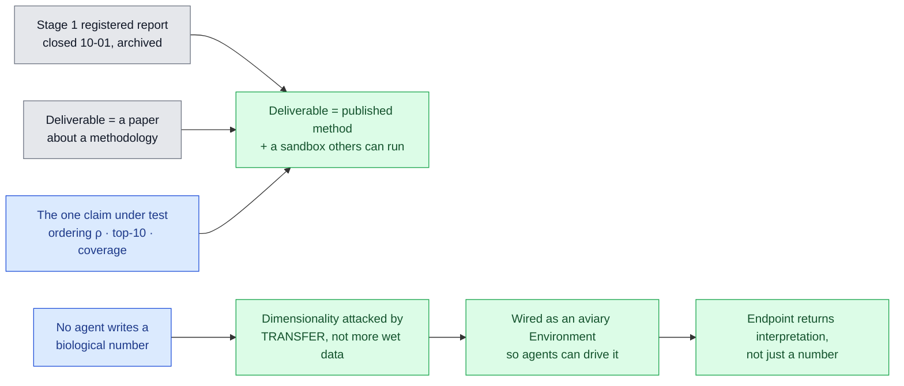

# Vision recorded 2026-10-14 — the virtual lung membrane as a shared sandbox

<!-- HACP L1 · Kind = Decision · Section = vision · Indexed by "ChipSim (bioFM) — Index".
     SOURCE OF TRUTH: the Notion row. This file mirrors it; see notion-map.json.
     This page SUPERSEDES the scope framing on index.md and vision.md where they conflict:
     the deliverable is no longer a registered report alone, it is a published method plus a
     working sandbox endpoint. Dated rows on the older pages stay as history. -->

**Kind:** Decision · **Layer:** L1 · **Holds:** the principal's vision input of 2026-10-14, the objective it sets, and what it changes · **Reaches:** [§decision](decision.md), [§experiment](experiment.md), [§vision](vision.md), the aviary-biosim environment contract

## The input, verbatim

> First. Clean up context and check records for up to date design direction on the research.
> Then, perform research analysis via undermind on feasible metholdogy to overcome the
> dimensionality curse using trainable and opensource embeddings or models on transportability
> to be able to build a virtual lung membrane or in silico lung chip simulation environment.
> Ensure that data sources are available and the sandbox can be built. Then, using aviary
> environment syntax, wire up the simulation environment as such to push for potential
> applications in systematic drug discovery, citing to overcome the validation barrier as the
> key scientific bottleneck.
>
> Define the objective to publish in professional journal, with deliverables including clean,
> modular code, supplementary context like figures & application analysis and, working endpoint
> to use the sandbox environment (with key request access portal, only name & valid email
> required. Documented in Notion for admin for direct testing). Be mindful that application or
> endpoint must also carry metadata & context on interpretability, not just a simulation result.
>
> Decision records of the session (including this vision input prompt) should be documented
> internally on HACP index, overwriting old or outdated context docs.

Route: principal, directly in Claude session
[session_0181c6Cgx1w4D61dgPg73r7f](https://claude.ai/code/session_0181c6Cgx1w4D61dgPg73r7f), 2026-10-14.
The CTO carries it into the approval log.

## What it changes

| | Before 2026-10-14 | After |
|---|---|---|
| **Deliverable** | a Stage 1 registered report on the methodology | a journal publication **and** a working sandbox endpoint others can request access to |
| **How the data problem is solved** | curate 80–100 chip records and fit a small model | **reduce effective dimensionality by transfer**: pretrained open embeddings and cross-platform transportability, with curation as the calibration set rather than the training set |
| **Interface** | a CLI and a frozen evaluator | additionally an **aviary `Environment`**, so an agent can drive the simulation as a tool-mediated experiment |
| **What a result is** | ordering ρ, top-10 recovery, Mondrian coverage | the same, **plus the interpretability context that makes the number actionable**: what drove it, what the model was uncertain about, and when it declined to answer |
| **The stated bottleneck** | the drug-delivery validation gap | unchanged in substance, sharpened in framing: **validation, not modelling capacity, is the rate-limiting step** |

**Unchanged and still binding.** The one claim under test. The standing constraint that no coding
agent writes a biological number, now with the 2026-10-08 amendment that the M1 inputs may be
agent-drafted from cited sources and principal-ratified. The sealed allocation, the three controls,
and the rule that the evaluator is signed before any fit on real records.

## The objective this sets

**Publish a method, and ship the sandbox that makes it checkable.** The paper's claim is not that
the simulation is accurate; it is that a *calibrated, abstaining* surrogate built from open
pretrained representations can shrink a wet-lab validation queue by a measurable amount, and that
the shrinkage is verifiable by anyone who requests a key.

The scientific framing is the validation barrier. A model that cannot say when it is wrong cannot
displace a wet experiment, regardless of its accuracy. So the publishable unit is the pairing of a
transfer-based predictor with a distribution-free guarantee and an abstention rule.

## Deliverables

| # | Deliverable | Done when |
|---|---|---|
| D1 | **Clean, modular code** | the simulation core, the embedding adapters and the calibration layer are separate importable modules, each with tests that can fail; `ruff`, `ty` and the suite green in CI |
| D2 | **The aviary environment** | a `LungMembraneEnv` conforming to the `Environment` contract already used by `BioSimEnv`: `reset` returns observations and tools, `step` refuses before it spends, reward is not fabricated |
| D3 | **Supplementary context** | figures and an application analysis showing what the method would do to a real screening queue, not only its metrics |
| D4 | **A working endpoint** | a request returns a prediction **with** its interpretability payload: the interval and its coverage basis, the subgroup it was conditioned on, the nearest supporting evidence, the assumed-versus-cited provenance of every parameter used, and an explicit abstention when out of domain |
| D5 | **The access portal** | name and a valid email only; a key issued on confirmation; documented in Notion so an admin can test the endpoint directly |

**D4 is the load-bearing one.** A result without its interpretation is the thing the validation
barrier is made of. The endpoint contract therefore treats the metadata as part of the response,
not as an optional verbose mode.

## What is not decided here

- The specific embedding model and calibration method: that is the research analysis, recorded in [§experiment](experiment.md) once the deep search is read.
- The journal. Named after the method is fixed, not before.
- Whether the sandbox serves the mechanistic surrogate alone or also the occupancy engine. Scoping follows the data audit.
- Nothing here releases the M1 inputs: T20, T28 and T21 remain owed, and the fit still refuses unsourced θ.

Back to the [index](index.md).
