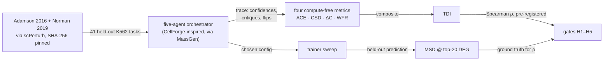

# perturb-seq-eval v0.6.0 — paper walkthrough

<!-- Surface skill: /walkthrough-paper · HACP Presentation · Project=bioFM · Section=eval · L1 — Review.
     Written by the CTO 2026-10-02; updated 2026-10-16 by the perturb-seq-eval agent on the
     principal's direction (research showcase: validated data sources cited, publication record).
     Every number comes from paper/sections/generated_numbers.tex (generated from
     artifacts/v0.6.0/summary.json), never typed; dataset digests come from the run's provenance.json. -->

| Row | |
|---|---|
| **Citation** | Mang-yin Mo · preprint · 2026 · Zenodo concept DOI [10.5281/zenodo.19716140](https://doi.org/10.5281/zenodo.19716140) (v0.6.0: [10.5281/zenodo.23422745](https://doi.org/10.5281/zenodo.23422745), published 2026-10-16) · Figshare [10.6084/m9.figshare.32086920](https://doi.org/10.6084/m9.figshare.32086920) (v0.6.0 = version 6: [10.6084/m9.figshare.32086920.v6](https://doi.org/10.6084/m9.figshare.32086920.v6)) · code: [repository at the run's commit `ce5f237`](https://github.com/supmo668/bioFM/tree/ce5f2379bac485930ff57c4b9e96a486676413a8/projects/perturb-seq-eval) |
| **Read level** | **FULL** — the pre-registration is the contribution; the negative result is the payload |
| **Modality** | cell — pooled CRISPR screens in K562 |
| **Wet-lab dependency** | **none** — two published Perturb-seq screens, re-used as measured |
| **Oracle chain** | sequenced transcriptome → normalised expression → MSD over top-20 DEGs → "task difficulty" (**3 hops, no wet lab**) |
| **Innovation tags** | **evaluation** *(trace metrics scored against held-out error)* · orchestration *(five-agent lifecycle as subject)* · data *(provenance-complete run record)* |
| **Stack role** | benchmark + method donor |

## Index
TL;DR · Context · Schematic · Data setup · Data provenance · Formulation · RL anatomy · Results · Limitations · Lineage · Publication record · Pen notes

## TL;DR
Multi-agent systems spend test-time compute uniformly; we asked whether the agents' own confidence-and-critique trace predicts which tasks are hard. Four of five pre-registered gates pass, the transfer gate fails, and the headline metric moves opposite to the registered direction.

## Context
Test-time compute is allocated flat because nothing cheap says which task deserves more. A trace the system already emits — confidences, critiques, winner flips — costs nothing extra to read. Whether it carries difficulty signal had not been tested under pre-registration, so a positive result here was indistinguishable from a search over metrics.

## Schematic

*The trace and the error come from two different halves of the system; the gates only ever compare them. Nothing in the loop optimises the metrics.*

> **The one thing to take away.** ACE correlates **negatively** with held-out error in both screens (ρ −0.628 Adamson, −0.376 Norman) — the opposite of the registered direction. Reported as a result, not reinterpreted: a sign flip found after the fact is a new hypothesis, not a finding.

## Data setup

| Field | |
|---|---|
| **Source** | two published K562 Perturb-seq screens, re-packaged by scPerturb; public (full citations and digests in *Data provenance*) |
| **Shape** | one task = (perturbation, held-out cells); prediction `ŷ ∈ ℝ^G`, scored on the top-20 DEG subset `ŷ[:20]` |
| **Size** | 41 held-out tasks — 21 Adamson, 15 Norman singletons, 5 Norman doublets; drawn deterministically |
| **Labels** | measured post-perturbation expression; no human labelling |
| **Role in training** | eval-only for the hypothesis tests; the trainer sweep fits per task |
| **Leakage guards** | deterministic draw fixed in the pre-registration before any data was seen; the two screens stay separate, and crossing them **is** H5 |

**Axes.** `G` = genes measured (32,738 Adamson; 33,694 Norman); `20` = the DEG cut, a ranking choice, not a biological constant; `41` = tasks, the unit every ρ is computed over — small, and the CIs say so.

## Data provenance — the validated sources

| Screen | Original study (peer-reviewed) | Perturbation | Run record (cells × genes) |
|---|---|---|---|
| **Adamson 2016** | Adamson B., Norman T. M., … Weissman J. S. *A Multiplexed Single-Cell CRISPR Screening Platform Enables Systematic Dissection of the Unfolded Protein Response.* **Cell** 2016 · [10.1016/j.cell.2016.11.048](https://doi.org/10.1016/j.cell.2016.11.048) | CRISPRi (knock-down) | 21,841 × 32,738 |
| **Norman 2019** | Norman T. M., Horlbeck M. A., … Weissman J. S. *Exploring genetic interaction manifolds constructed from rich single-cell phenotypes.* **Cell** 2019 · [10.1016/j.cell.2019.05.031](https://doi.org/10.1016/j.cell.2019.05.031) | CRISPRa (activation), singles + doublets | 44,423 × 33,694 |

**Packaging.** Both are taken from **scPerturb** — Peidli S., Green T. D., Shen C., *et al.* *scPerturb: harmonized single-cell perturbation data.* **Nature Methods** 2024 · [10.1038/s41592-023-02144-y](https://doi.org/10.1038/s41592-023-02144-y) — pinned to Zenodo record [13350497](https://zenodo.org/records/13350497). Every file is fetched SHA-256-gated (an unpinned file is refused) and the digests below are the ones **the run itself recorded** in `provenance.json`.

| scPerturb file (Zenodo 13350497) | SHA-256 (as recorded by the run) |
|---|---|
| `AdamsonWeissman2016_GSM2406675_10X001.h5ad` | `119e3c1cf7dede4e13f887b86f9bcd797a9dc29213ee57d36aa80012d93f1c1c` |
| `AdamsonWeissman2016_GSM2406677_10X005.h5ad` | `6c6eca0f53f8887b86597e2a4ff512ff2b2d3d9c78ee7deec9a6e7d6ae859d01` |
| `AdamsonWeissman2016_GSM2406681_10X010.h5ad` | `e70fcd49808cab8d724de8d5a332940911206e1c8ef44cc7b568d048ed795c85` |
| `NormanWeissman2019_filtered.h5ad` | `efde6f5301fe256725dce1d980f37bd96a13481a9a16135515897368e631affc` |

## Formulation

Agent Confidence Entropy over a round's normalised confidences:

$$\mathrm{ACE} = -\sum_i p_i \log p_i \quad\text{where } p_i = c_i / \textstyle\sum_j c_j$$

The composite scored by H4/H5:

$$\mathrm{TDI} = w_1\,\mathrm{ACE} + w_2\,\mathrm{CSD} + w_3(1-\Delta C) + w_4\,\mathrm{WFR}$$

**Every scalar, traced.**

| Scalar | Producer · fit · units · direction · hops |
|---|---|
| **MSD @ top-20 DEG** | mean squared deviation of predicted vs measured expression over the 20 most differentially expressed genes · fit to nothing, it *is* the measurement · dimensionless on normalised counts · lower = better · **3 hops** from sequencing to score |
| **ACE** | entropy over the agents' self-reported confidences · fit to nothing · nats · registered as *higher = harder* (**the data disagrees**) · 1 hop, and the hop is self-report |
| **TDI** | weighted sum above, weights calibrated on Adamson · dimensionless · higher = harder · inherits every component's hops |

*Gate cutoffs where they bind: H1 median MSD < 0.20 · H2 < 0.30 · H3 entropy ≥ 0.5 nats · H4 any ρ > 0.5 · H5 transferred ρ > 0.4.*

## RL anatomy

| Slot | What fills it |
|---|---|
| **policy** | **N/A** — no policy is learned; the orchestrator is a fixed five-role workflow with a pinned model roster |
| **reward** | **N/A** — MSD is an evaluation metric, never fed back; nothing optimises against it, which is what keeps it honest |
| **environment** | the MassGen-operated orchestrator plus the trainer sweep |
| **data/labels** | two public Perturb-seq screens; labels are measured expression |
| **algorithm** | **N/A** — pre-registered correlation tests, not an update rule |

*Four N/As is the finding: this evaluates an agentic system; it is not a training method. The absence is why no gate can be reached by optimisation.*

## Results
- **4 / 5 gates pass, exactly as pre-registered.** H1 Adamson median MSD **0.132** (CI 0.111–0.149, n = 21) · H2 Norman **0.184** (CI 0.092–0.395, n = 20; doublets 0.517) · H3 backbone-choice entropy **0.859 nats** · H4 **4** within-dataset ρ pass, carried by 1−ΔC and TDI_lifecycle (ρ 0.66–0.70).
- **H5 FAILS.** The Adamson-calibrated composite transfers to Norman at **ρ = 0.286** (n = 20, CI −0.244–0.726) against a registered 0.4. It stays failed.
- **The run can be audited.** 123 lifecycle runs, 1,845 LLM steps (1,846 calls), **0 fallbacks · 0 cache hits · 0 refusals · 0 served-model mismatches**; total spend **$8.93** against a $12 stop and a $30 ceiling.

## Limitations / oracle risk
- **Scope.** Single model family — no cross-family generality; same-family judge on a different tier, residual bias acknowledged, not removed.
- **Power.** n = 21 / 20 per screen; bootstrap CIs are wide, and H5's spans zero. The ACE sign is a hypothesis to test next, never a claim.
- **Convention.** MSD over a top-20 cut is a ranking choice; a different cut is a different difficulty.
- **Reproduction.** The analyser reproduces the committed `summary.json` bit-for-bit on Python 3.12; the run itself ran on 3.11.0, where one quantity (the backbone entropy) is one unit in the last place higher — no reported figure or gate changes. Disclosed in the paper.

## Lineage
Builds on CellForge (orchestrator shape) and MassGen (operation); Adamson 2016 and Norman 2019, via scPerturb, supply the screens. Enables: a pre-registered template for scoring agent traces against task outcomes, and a registered follow-up on the ACE sign.

## Publication record

| | |
|---|---|
| **Form** | v0.6.0 is the **next version** of the existing records (no duplicate record; principal D-1 = B): Zenodo concept `19716140`, Figshare `32086920`. v0.5.x stays reachable as earlier versions, superseded in full (corrections appendix) |
| **Status** | **published 2026-10-16** on both venues; verified by public read-back — same 5 files, same md5s on both, one author |
| **Links** | Zenodo [record 23422745](https://zenodo.org/records/23422745) · concept [10.5281/zenodo.19716140](https://doi.org/10.5281/zenodo.19716140) · Figshare [v6](https://doi.org/10.6084/m9.figshare.32086920.v6) |

## Pen notes

<b>Perturb-seq</b> — pooled CRISPR screen read out per cell by RNA-seq

Each cell gets one perturbation and its whole transcriptome is sequenced. Thousands of (perturbation → expression) pairs from one experiment. Here it supplies both the task and its answer key. Nearest analogue: a labelled dataset whose label is 20,000-dimensional.

<b>CRISPRi vs CRISPRa</b> — knock a gene down, or drive it up

Adamson is interference (down), Norman is activation (up). Not the same prediction problem — which is exactly why H5, transfer between them, was registered as a separate gate. It failed.

<b>scPerturb</b> — one harmonised packaging of many published screens

Re-publishes public perturbation screens with shared metadata columns (Nature Methods 2024). It changes the format, not the measurements. Pinning its Zenodo record and each file's SHA-256 means "the same data" is checkable, not assumed.

<b>MSD @ top-20 DEG</b> — error scored only on the genes that moved

Scoring all genes rewards predicting "nothing changed", which is almost true. Restricting to the top 20 differentially expressed genes makes the metric about the perturbation's effect. The cut is a convention; 0.20 and 0.30 are the registered thresholds.

<b>Pre-registration</b> — hypotheses and cutoffs fixed before the data

Amendment 4 was locked before any run. Without it, "4 within-dataset correlations pass" is a search result. With it, the tally is a measurement — and the failure has to be reported too.

<b>Spearman ρ</b> — rank correlation, not linear

Asks whether harder tasks *rank* harder, not whether the relation is a line. Right when a composite index's scale is arbitrary. n = 20–21 here, so the CIs are wide and one spans zero.

<b>Served-model mismatch</b> — you asked for one model and got another

A silent substitution would invalidate every per-model claim. Each call records the served model id and stop reason; the run reports **0** mismatches and **0** fallbacks. This is the provenance half of the contribution.

