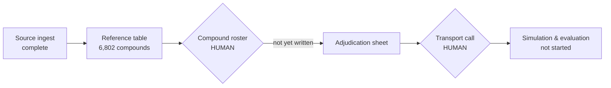

# The rig is built. The experiment has not run.

**Product cut.** The technical cut was not written: this walkthrough was requested as a
one-pager for the principal, and the skill's own rule is that two thin cuts are worse than
one good page when only one audience is real.

The pipeline produced its **first real artifact** — a 6,802-compound reference table whose
contents can be checked byte-for-byte by anyone. Everything downstream of it is waiting on
inputs only a human may write.

| | |
|---|---|
| 6,802 | compounds, 9 attributes, digest-verified |
| 1 of 5 | human-owned inputs delivered |
| 0 | simulation or evaluation runs |

Counts read from the artifact itself, not from a build report. The row and column counts were
read out of the parquet, and the tracked digest was recomputed over the bytes on disk.

## Where the work stops

Green has run. Amber needs a person. Grey cannot start until the amber above it clears.

## What changed

- **Before:** the pipeline had produced nothing; its output folders were empty.
- **Now:** it produces a reference table, records the exact settings of every run, and asks
  for confirmation before it writes.
- The safety check that keeps licensed source content out of the repository has been hardened
  repeatedly — and it kept finding real faults, including several in itself and two in the
  CTO's own instructions.

## The risk worth naming

Most of the recent effort went into making the verification layer trustworthy rather than into
moving the science forward. That was the right call while the checks were unreliable — but it
is a cost, and the team surfaced it before the CTO did.

## The decision in front of you

The **compound roster** — roughly 20–40 curated entries — is the single item that unblocks the
chain. It is a curation claim, so no agent may write it. Everything downstream idles until it
exists.

## What this does not claim

- No biological result has been produced, reviewed or validated. **There is nothing yet to publish.**
- The reference table is ingested source data, not an experimental output.
- The content guard is available but **not enforced** — nothing automatically runs it before a
  commit. That remains the principal's call.
- One source licence is still unconfirmed.

---

## Surface annotation — 2026-10-30: one citation DEAD, one DEGRADED — they are not the same

Both artifact pointers in this file's frontmatter were read today. They are in **different**
states, and a reader deserves the difference.

**A disambiguation this annotation must not blur.** Everywhere in the body above, "artifact"
means the **6,802-compound reference table** — a parquet in the pipeline's own output,
digest-verified, nothing to do with a web surface. The two URLs below are *publication
surfaces*. Nothing in this section is a statement about the reference table.

| pointer | state today | read result |
|---|---|---|
| `artifact_history:` → `Pw8C8QxzqL2FTuMEJ7w8tp` | **DEAD** | artifact not found |
| `artifact:` → `HDtaxnfh79HumoLY7NWKws` | **DEGRADED, not dead** | resolves; returned as third-party content authored outside this organization |

**DEAD — `Pw8C8QxzqL2FTuMEJ7w8tp`.** This file already recorded that it stopped resolving on
2026-09-29. **That claim is re-confirmed today rather than inherited**: the read returns not
found. It was the original 2026-09-19 publication, and it is gone.

**DEGRADED — `HDtaxnfh79HumoLY7NWKws`.** The URL resolves, and the page is still substantively
this walkthrough: the read returns the 6,802 figure, the 2026-09-29 re-measured state table, and
this file's own path as its stated source. What has degraded is not the content but the
**provenance channel** — the read comes back marked as a *public artifact authored outside this
organization*, delivered as an isolated summary of untrusted third-party data rather than as this
project's own page. Authorship cannot be established from it, and this account can neither read
it as raw text nor edit it. It can still be opened; it can no longer be *vouched for*. A citation
whose authorship a reader cannot establish is not provenance, whatever it renders.

**Degraded is not dead, and the distinction is load-bearing.** A dead URL announces its own
failure. A degraded one keeps rendering plausible content while quietly losing the single
property a citation exists to carry. The second is the more dangerous of the two, because
nothing about opening it looks wrong.

**What survives.** The substance is in this file: the counts, the blocked-chain diagram, the
named risk, the decision, and the four explicit non-claims. The counts were read from the parquet
and the tracked digest recomputed over the bytes on disk, so they are reproducible from the
repository without either URL.

**Do not re-point either field — and do not "fix" the degraded one by republishing.** Both are
left as dated records; deleting them would erase the evidence that the surfaces existed.
claude.ai artifact URLs are **account-scoped**: unreadable from any account but their author's,
and dead for every reader of a published paper from the moment of publication. Republishing buys
a URL that fails the same way again — which is precisely what the 2026-09-29 republication, now
itself degraded, demonstrates. Durable provenance goes in-repo.

**Scope of this check, and one unresolved observation.** Only the two artifact URLs were read.
`hacp_row:` was **not** re-read today and nothing here claims it resolves — but it is worth
recording that its page id does **not** appear in `docs/hacp/lung-on-chipsim/notion-map.json`, so
it sits outside the floor's sync discipline and `hacp_sync_check.py` does not cover it. Stated as
a measured gap, not diagnosed.
